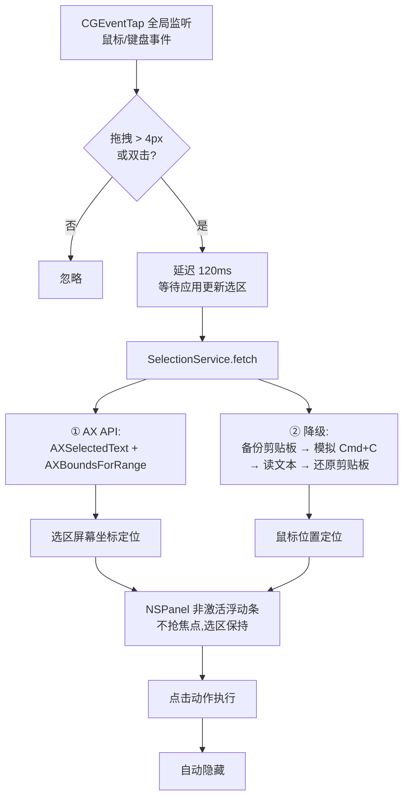

<p align="center">
  
</p>

<h1 align="center">PopBar</h1>

<p align="center">
  一个 macOS 划词工具条 —— 选中文字,即出菜单。<br>
  纯 Swift + AppKit 实现,无 Xcode 工程依赖,单文件编译打包。
</p>

<p align="center">
  中文 | <a href="README_EN.md">English</a>
</p>

<p align="center">
  <br>
  
</p>

<p align="center">
  <a href="docs/popbar-promo-v2.0.mp4"></a><br>
  <a href="docs/popbar-promo-v2.0.mp4">▶ 观看宣传片</a> · <sub>69 秒:划词即弹 · 上下文感知 · AI 翻译 · 隐私脱敏 · 截屏标注 · 录屏导出</sub>
</p>

## 特性

- **划词即弹**:鼠标拖拽 / 双击选中文字后,浮动工具条出现在选区上方
- **内置动作 + 可编排工具条**:覆盖剪贴板、文本处理、搜索、翻译、语音等场景;偏好设置里可拖拽排序、显示/隐藏,多余的收进「…」溢出菜单
- **AI 翻译面板**:接入任意 OpenAI 兼容服务(DeepSeek / 硅基流动 / Ollama…),多个 provider 并行流式返回译文对比;支持**多轮追问**
- **上下文感知**:识别 URL / 邮箱 / 算式 / 时间戳 / JSON / Base64 / URL 编码 / 颜色 / 文件路径 / 电话 / 地址 / 日期 / 币种 / 单位,自动追加对应按钮(最多 3 个)
- **按应用规则**:1Password、终端等敏感应用可整体禁用弹条,或只保留指定按钮;菜单栏可一键对当前 App 禁用/启用
- **隐私优先**:AI 请求前检测手机号、身份证、银行卡、API Key、私钥、内网 IP,可选询问 / 自动脱敏;剪贴板历史默认关闭、默认不落盘
- **扩展系统**:URL 模板 / Shell 脚本(stdin 传文本,防注入)/ 快捷指令三类扩展,配置即生效
- **更多内置工具**:二维码生成、开发者工具箱(HTML/Unicode 转义、SHA256/MD5、JWT 解码、JSON 处理)
- **录屏**:选区 / 窗口跟随 / 整屏录制(`ctrl+opt+r`,macOS 15+)——倒计时开录、H.264/HEVC、MOV/MP4、30/60fps、系统声音与麦克风、暂停、标记点、摄像头画中画、点击涟漪、水印、统一导出面板(裁剪 / 压缩 / 混音)、可导出 GIF
- **截屏**:微信式截屏(`ctrl+opt+p`)——冻结画面、自动识别窗口、像素放大镜与取色、矩形/椭圆/箭头/画笔/文字/马赛克/序号标注、贴图、文字识别、长截图,可选本地截图历史
- **菜单栏翻译入口**:截图 OCR / 输入 / 剪贴板三种方式直接唤起翻译面板;截图与剪贴板图片还会识别二维码
- **系统监控**:菜单栏「系统监控」弹出实时面板——健康评分、CPU(含每核)/ GPU / 内存 / 电池 / 磁盘 / 网络 / 温度,以及按**应用分组**、可**滚动、搜索**的进程表;点击任意一行弹出**进程详情**(来源链、launchd 触发原因、置信度、警告、成员进程…),右键 / 「…」菜单可固定行、在访达中显示、复制名称 / PID、终止、强制退出。样式与翻译面板一致,仅在面板打开时采样
- **磁盘清理**:菜单栏「磁盘清理」扫描 App 缓存与旧日志、开发工具(Xcode / Homebrew / Cargo / Gradle …)、AI 工具缓存与卸载残留,按大小排序、分类勾选,**一律移入废纸篓**(可放回原处);运行中的 App 自动加锁,只清理用户目录、不需要管理员权限
- **系统维护**:菜单栏「系统维护」提供刷新 DNS、精简 Time Machine 本地快照、重建 Spotlight 索引、整理「打开方式」数据库、重置快速查看缓存;只做确有效果的操作,需要管理员权限的任务由系统弹出密码框,不装任何特权助手
- **启动项**:菜单栏「启动项」列出登录项与后台服务(LaunchAgent / LaunchDaemon),用户级可开关(`launchctl enable/disable`,重新登录生效,不改第三方 plist),系统级仅展示,指向已卸载程序的损坏启动代理可移入废纸篓
- **剪贴板历史**:可选开启,记录文字/图片/文件(最多 10 条,可置顶),菜单栏条目子菜单提供粘贴/仅复制/追加/置顶;默认关闭、默认内存存储不落盘,密码类剪贴板标记一律跳过
- **键盘操作**:可配置全局快捷键唤起;键盘模式期间 ←/→ 移动高亮、Enter 执行、Esc 关闭,自动限时摘除拦截
- **中英双语界面**:菜单栏、浮动条、翻译面板、两个设置窗口均即时切换
- **智能排序建议**:本地使用统计(只记动作次数)驱动,每周最多一次建议把高频动作固定到主条
- **无侵入取词**:优先 Accessibility API,降级为模拟 `Cmd+C` 并自动还原剪贴板
- **就地替换**:大小写转换、Dev 菜单里的「→ 替换」项直接改写原文(剪贴板先备份后还原)
- **明暗双主题**:毛玻璃材质与图标颜色随系统外观自适应
- **零依赖后台运行**:`LSUIElement` 无 Dock 图标,纯事件驱动,空闲 CPU ≈ 0

## 按钮一览

| 图标 | 动作 | 说明 |
|---|---|---|
| 📄 | 复制 | 选中文字写入剪贴板 |
| ✂️ | 剪切 | 模拟 `Cmd+X` |
| Aa | 大小写转换 | 就地替换;全大写则转小写 |
| 🔍 | Google 搜索 | 浏览器打开搜索结果 |
| 🐾 | 百度搜索 | 同上 |
| 💬 | AI 翻译 | 打开多 provider 翻译面板,流式显示各家译文;未配置 provider 时打开设置窗口 |
| 🔊 | 朗读/停止 | AVSpeechSynthesizer,中文自动选中文语音 |
| #️⃣ | 字数统计 | 弹条内直接显示「字符 X · 词 Y」 |
| 🔗 | 打开链接 | 仅当选中内容像 URL 时出现 |
| ✉️ | 发邮件 | 仅当选中内容是邮箱时出现 |
| ⊖ | 计算 | 仅当选中内容是算式时出现,复制结果 |

> 工具条按钮悬停会显示名称提示;
> 上下文按钮最多显示 3 个,按识别优先级取前三个:URL、邮箱、算式、时间戳、JSON、
> 颜色、文件路径、Base64、URL 编码、币种、单位、电话、地址、日期。
> 扩展动作、二维码、脱敏、Dev 工具箱等都可在偏好设置里自由排序与显隐。

## 键盘模式

键盘选中(Shift+方向键/Home/End/PgUp/PgDn,防抖 0.45s 判定)同样能弹出工具条;
按下唤起快捷键(默认 `ctrl+opt+space`,可在偏好设置修改)则进入**键盘模式**:

- `←`/`→` 移动高亮,`Enter` 执行
- `Esc` 关闭;30 秒无操作自动退出(防 tap 卡死键盘)

## 隐私与安全

- **敏感信息检测**:AI 请求前检查手机号 / 身份证 / 银行卡 / 邮箱 / API Key / 私钥 / 内网 IP;可选「询问 / 自动脱敏 / 关闭」;脱敏用占位符发送,返回后原位还原;本地 provider(localhost / 内网地址)直接放行
- **API Key 不外泄**:key 明文存本机 config.json(权限 0600)
- **密码框豁免**:聚焦安全输入框(AXSecureTextField)时完全不取词,剪贴板兜底同样禁用
- **剪贴板保护**:自身写入统一登记,历史不误存降级取词的临时内容;ConcealedType / TransientType 一律跳过
- **扩展隔离**:Shell / Shortcut 扩展文本只走 stdin + 环境变量,不拼命令串;默认 10s 超时强杀
- **应用黑名单**:敏感应用可整体禁用取词;菜单栏可一键对当前 App 禁用/启用
- **截屏保护**:PopBar 自己的窗口不会出现在截图里;截图历史默认关闭,开启后也只存本机 Application Support/PopBar/Snaps 并按保留数量自动清理;截屏内容不会上传,除非你自己点「文字识别」走 AI 翻译

## 工作原理



关键实现:

- **事件监听** `.cgSessionEventTap` + `listenOnly`,不阻断系统事件流
- **取词降级链** AX → 剪贴板快照/还原(`(type, Data)` 物化,规避懒加载 item 的 `writeObjects:` 崩溃)
- **面板** `NSPanel` + `.nonactivatingPanel`,点击按钮时前台 App 焦点与选区不丢失——模拟按键替换选区等操作都依赖这一点
- **悬停反馈** `NSTrackingArea` + `.activeAlways`,accessory 应用下依然生效
- **Chrome/Electron 兼容** 自动设置 `AXEnhancedUserInterface`

## AI 翻译面板

<p align="center">
  
</p>

点击弹条上的 💬 按钮,会打开一个翻译面板:顶部是原文(可选中、可朗读),
下面是每个 provider 一张卡片,译文**流式**逐字出现;每张卡片都有复制、朗读和重试,
失败的 provider 会单独显示错误,不影响其它家。面板出现在屏幕中上方,左上角 📌 可钉住
(钉住后点击面板外不关闭,Esc/✕ 仍可关)。

菜单栏还提供三种触发方式:

| 入口 | 说明 |
|---|---|
| 截图翻译(OCR) | 系统选区截图 → Vision 离线 OCR(中英)→ 进面板翻译;需要「屏幕录制」权限,首次会引导授权;识别后还会检测二维码,命中弹出可点击的结果条 |
| 输入翻译 | 面板原文区变为输入框,Enter 提交、Shift+Enter 换行,可反复修改重译 |
| 剪贴板翻译 | 剪贴板是文本直接翻;是图片则先 OCR 再翻 |

菜单栏的截屏相关入口:

| 入口 | 说明 |
|---|---|
| 截屏 | 唤起截屏(同全局快捷键,默认 `ctrl+opt+p`);详见下方「截屏」 |
| 录屏 / 停止录屏 | 唤起录屏选区或停止当前录制(默认 `ctrl+opt+r`);详见下方「录屏」 |
| 系统监控 | 打开 / 关闭系统监控面板;详见下方「系统监控」 |
| 磁盘清理 | 打开 / 关闭磁盘清理面板;详见下方「磁盘清理」 |
| 最近录制 | 有录制记录时显示;每条可打开 / 在 Finder 中显示 / 复制路径或文件 / 导出 GIF / 移到废纸篓 |
| 截图历史 | 偏好设置里开启且有记录时显示;每条带缩略图,可复制 / 贴图 / 在 Finder 中显示,底部可打开文件夹、清空历史 |

菜单里的其他条目:启用/停用划词弹条总开关、对当前 App 一键禁用/启用、
剪贴板历史(开启后显示)、AI 翻译设置、偏好设置、辅助功能设置、退出。
左键点菜单栏图标的行为可在偏好设置里改为「输入翻译 / 剪贴板翻译」,右键始终弹菜单。

## 系统监控

菜单栏 →「系统监控」弹出一个与翻译面板同款外观(毛玻璃 + 淡紫渐变,明暗自适应)的实时面板,Esc 或右上角 ✕ 关闭,可拖动。

| 区块 | 内容 |
|---|---|
| 健康评分 | 综合 CPU 负载、内存压力、磁盘空间、电池健康与循环、温度、磁盘读写、开机时长、硬盘故障风险,给出分数、评级和影响项 |
| CPU / GPU | 占用率与温度、每核柱状条(CPU)/ 曲线(GPU)、芯片功耗(CPU / GPU / ANE / DRAM) |
| 内存 | 占用率与压力等级、曲线、已用 / 总量、交换用量 |
| 电池 | 电量与充电状态、健康度环、循环次数、最耗电进程(台式机显示「无内置电池」) |
| 磁盘 / 网络 / 温度 | 可用空间与占用条;实时上下行速率与曲线;CPU / GPU 温度与 5 分钟峰值、散热状态 |
| 进程 | 按**应用分组**(一个 App 的主进程与全部 Helper 合成一行,名称后的小数字是进程数,内存 / CPU 为合计),非 App 进程各占一行;按能耗排序,**可滚动**;搜索框按应用名、路径或任一成员 PID 过滤并显示「匹配数 / 总数」,Esc 先清空搜索再关闭面板;**点击一行打开详情** |

### 进程详情

<p align="center">
  
</p>

点击进程行(或菜单里的「为什么在运行?」)弹出详情窗;Esc 先关详情、再按一次才关面板,× / 点击窗外也可关闭:

| 区块 | 内容 |
|---|---|
| 摘要 | 进程数 · CPU · 内存 · 用户 · 一句话来源(如「由系统后台服务管理」) |
| 启动链 | `launchd 1 › Cursor 45525`,可展开完整链路;下方一句话说明来源(launchd 服务 / SSH 登录 / 由终端 X 启动 / 由 X 启动 / 来源未知) |
| 警告 | 以 root 运行、监听公开网络接口、阻止系统睡眠、设置了 DYLD 注入变量、程序文件被替换、连续运行超 90 天、进程已暂停、僵尸进程、来源未知 |
| 字段 | 置信度(高 / 中 / 可能)与识别依据、归属(子进程:某 App)、launchd 触发原因(`launchctl blame`)与服务 label、Plist / 自动保活 / 触发条件、线程数、打开文件、监听端口、阻止睡眠、磁盘 I/O、用户、启动时间、工作目录、Git 仓库、组外子进程、可执行文件 |
| 成员进程 | 组内按内存排序的前 6 个(PID / CPU / 内存,带「阻止睡眠 / 公开端口」标记),其余合并为「其余 N 个进程」 |
| 原始路径与命令 | 折叠区:可执行文件路径与完整启动命令 |
| 操作 | 复制摘要、在访达中显示、终止、强制退出 |

终止 / 强制退出会先确认,并校验 PID 没有被系统复用(详情打开期间进程换成了别的程序会提示「进程在查看过程中已变化」);系统关键进程(PID 1、PopBar 自己、系统目录下由 root 运行的程序)不可终止;无权限、进程已退出都有明确提示。App 的「终止」等同 ⌘Q(允许保存),「强制退出」对该 App 的全部进程发 SIGKILL。

进程的上下文菜单(右键整行,或点行尾「…」):

| 菜单项 | 说明 |
|---|---|
| 固定行 / 取消固定 | 把进程固定在列表最前(仅内存保存,退出 PopBar 后清除) |
| 为什么在运行? | 打开上面的进程详情 |
| 在访达中显示 | 在 Finder 中选中该进程的可执行文件 |
| 复制进程名称 / 复制 PID | 写入剪贴板(不进剪贴板历史) |
| 终止 / 强制退出 | 确认后结束该行(App 为整个应用);规则见上 |

<p align="center">
  
</p>

采样(IOReport / IOKit / libproc,不需要额外权限)只在面板可见时运行,关闭即停,不影响 PopBar 空闲时 CPU ≈ 0。
采集层是 `Native/metrics.c`(C),经桥接头文件 `Native/CMetrics.h` 供 Swift 调用。温度与分项功耗读数仅 Apple Silicon 有,Intel 机器上相应项显示 0 或「—」。

## 磁盘清理

菜单栏 →「磁盘清理」弹出与系统监控同款外观的面板,打开即自动扫描(`du` 并发测量),Esc 或 ✕ 关闭;**只清理用户目录,不需要管理员权限,不装任何特权助手**。

<p align="center">
  
</p>

| 分类 | 扫描范围 | 默认 |
|---|---|---|
| App 缓存与日志 | `~/Library/Caches/*`、`~/Library/Logs/*`、`~/.cache` 中不在已知工具表里的目录 | 缓存与日志勾选;`com.apple.*` 与未知目录需确认(不勾) |
| 开发工具 | Xcode DerivedData / DeviceSupport / SourcePackages、CoreSimulator 缓存、Cargo、Gradle、Maven、pub、Go 模块、Homebrew、`~/.cache` 下 pnpm / uv / pip / playwright 等,以及 npm 缓存 | 可再生的勾选;Swift 包缓存与 Go 模块需确认 |
| AI 工具 | `~/.cache` 下 claude / codex / cursor-agent / ollama / torch 等 | 模型缓存(torch / ollama)需确认 |
| 卸载残留 | `~/Library/Containers`、`~/Library/Application Support` 中找不到宿主 App 的 bundle id 目录 | 一律不勾选 |
| 手动管理 | Claude 虚拟机镜像、Ollama 模型、Hugging Face 模型 | 只显示占用,不参与清理 |

安全设计:

- **移入废纸篓,可恢复**。清理前会确认;进了废纸篓的空间要清倒废纸篓后才真正释放,面板里的结果条带「打开废纸篓」。唯一例外是 **npm 缓存**:它是内容寻址缓存,粗暴删除会毁掉全部有效缓存,所以只做**引用图分析**——扫描 `index-v5` 找出所有被引用的内容,只直接删除无引用的孤儿 blob 与 `tmp/` 残留(有效缓存保留,npm / node 运行中跳过)
- **路径复核**:执行时对每一项重新校验——必须是绝对路径、无 `..`、不是符号链接、位于允许的清理根之下且不能是根本身、不碰系统目录;评审阶段的勾选状态不被信任
- **占用检测**:所属 App 正在运行的条目加锁(显示「使用中」),不可勾选;执行时再复核一次
- PopBar 自己的缓存与日志、Safari 数据永不进入清单
- 操作记录写入 `~/Library/Logs/PopBar/clean.log`(时间 / 操作 / RAN 或 SKIPPED / 条目数 / 详情)
- 面板按分类分 tab;底栏的「已选 / 全选 / 全不选 / 推荐 / 移入废纸篓」只作用于**当前 tab**,其他 tab 里的勾选不会被统计,也不会被清理
- 每一行有「移到废纸篓」与「在访达中显示」按钮,可只处理单项

## 截屏

菜单栏 →「截屏」或全局快捷键 `ctrl+opt+p`:所有屏幕瞬间冻结并变暗,PopBar 自己的窗口不会出现在截图里。
鼠标悬停会高亮窗口,点击直接选中该窗口,也可以拖拽自定义选区;选区下方出现工具条。
需要「屏幕录制」权限,与截图翻译共用同一项授权,首次使用会引导授权。

<p align="center">
  
</p>

- **放大镜**:拖选时显示 8 倍像素放大镜、像素坐标与 RGB/HEX 颜色,按 `C` 复制光标处颜色(偏好设置可关闭)
- **标注**:矩形、椭圆、箭头、画笔、文字、马赛克、序号;3 档粗细、6 种颜色(记住上次选择),可撤销/重做;
  选中工具或已有标注后选区锁定。按住 Shift:矩形/椭圆约束为正方形/正圆,箭头吸附 45°
- **输出**:完成(复制到剪贴板)、保存(到偏好设置里的目录,文件名 `PopBar yyyy-MM-dd at HH.mm.ss`,PNG/JPG)、文字识别(进翻译面板)、贴图
- **长截图**:点工具条上的长截图按钮后选区变成虚线框,**向下缓慢滚动**目标内容,PopBar 自动拼接并在旁边的面板里实时预览,
  `Return` 或「完成」复制,`Esc` 或「取消」放弃;上限 20000 px,提示「请慢一点滚动 / 请向下滚动」时调整滚动方式。有标注时不可用
- **截图历史**:偏好设置里可开启(默认关闭),PNG 存于本机 `Application Support/PopBar/Snaps`,按保留数量(1–200)自动清理最旧的

| 操作 | 说明 |
|---|---|
| `ctrl+opt+p` | 开始截屏(偏好设置可改) |
| `Esc` | 取消截屏(编辑文字时,第一次 Esc 只确认文字) |
| `Return` / `⌘C` | 完成并复制 |
| `⌘S` | 保存到指定目录 |
| `⌘Z` / `⇧⌘Z` | 撤销 / 重做标注 |
| `←→↑↓` / `Shift`+方向键 | 微调选区 1 pt / 10 pt(未锁定时) |
| `C` | 复制光标处颜色 HEX |
| 双击选区 | 完成并复制(未选标注工具时) |
| 右键 | 已选工具 → 取消工具;已有标注 → 无操作;已选区 → 回到选择状态;否则取消截屏 |

**贴图窗口**:悬浮在原位置,可拖动;滚轮缩放 10%–500%(以光标为中心);双击或 `Esc` 关闭;`⌘C` 复制;
右键菜单:复制 / 保存 / 文字识别 / 透明度(100% 80% 60% 40%)/ 关闭。

## 录屏

菜单栏 →「录屏」或全局快捷键 `ctrl+opt+r`（macOS 15+）:先进入与截屏相同的选区界面,
点工具条上的 **红色录制按钮**（或直接 `Return`）就开始录;**直接点击屏幕不选区 = 录整屏**。
**选区正好落在一个窗口上 = 跟随该窗口录制**（窗口移动、缩放、被遮挡都自动跟随）。
默认先倒计时 3 秒再开始采集（0/3/5/10 可调）,留出切窗口、摆界面的时间,这段不会进片子。
选区会被红线框住,旁边的面板显示 mm:ss 计时与**暂停 / 标记 / 隐藏面板 / 停止**四个按钮,菜单栏图标同时变成红色计时器。

<p align="center">
  
</p>

- **输出**:默认 H.264 / MOV / 30fps / 2x 原生像素,保存位置沿用截屏的保存目录,文件名 `PopBar-Rec-yyyyMMdd-HHmmss`
  （同名自动加 `-2`、`-3`）;文件用 `SCRecordingOutput` 直接落盘,录制中已在写盘,异常中断也能保住已录部分
- **停止**:面板「停止」、全局快捷键再按一次、菜单栏「停止录屏」,任一方式都等同;完成后系统通知提示时长与体积,
  通知上直接给出**播放 / 编辑并导出 / 导出 GIF** 三个动作;GIF 文件的通知只保留「播放」
- **标记点**:`ctrl+opt+shift+m` 或面板按钮;导出面板里可以一键把起止点跳到任意标记,掐头去尾不用拖时间轴
- **暂停**:`ctrl+opt+shift+r` 或面板按钮;暂停时边框变橙、计时停止,继续后新片段在结束时自动拼接为单个文件
- **退出保护**:录制中退出 PopBar 会同步收尾,保证 moov 写完、文件可播放
- **退出时长限制**:偏好设置里可设最长时长(秒,0 = 不限),到时自动停止并保存
- **记忆选区**:每块屏幕各自记住上次录过的区域,选区界面按 `R` 恢复
- **麦克风**:默认关闭;开启后才需要「麦克风」权限,系统声音默认开启(PopBar 自己的声音始终排除)
- **录 GIF**:⌥+点录制按钮 = 直接录 GIF(≤30s、10fps、宽 ≤800),中间的 .mov 自动删除;
  也可以从「最近录制」或完成通知的「导出 GIF」按钮打开导出面板(帧率 / 宽度 / 区间 / 体积预估 / 进度 / 取消),导出后可自动复制到剪贴板
- **导出视频**:「最近录制」→「编辑并导出…」打开统一导出面板 ——
  区间裁剪、目标宽度(原始/1920/1280/854)、质量档(高/中/低)、MP4/MOV、系统声音与麦克风独立音量、
  点击涟漪、摄像头画中画、水印,一次导出全部生效;输出 moov 前置,网页与微信可直接播放
- **点击涟漪**:录制时只记录点击(鼠标事件全局监听,**不需要辅助功能权限**;落在录制控制面板、摄像头预览窗上的点击不计入),导出时才烧进画面 ——
  圆环出现在点击的位置与时刻,颜色/时长在偏好设置里调
- **摄像头画中画**:偏好里开启后需要「摄像头」权限;录制时按配置的角落显示预览窗(所见即所得),
  导出时把摄像头画面合成到成品上
- **要发给别人**:偏好里「套用产品演示参数」一键切到 1x + MP4 + H.264 + 30fps + 倒计时 3 秒

| 操作 | 说明 |
|---|---|
| `ctrl+opt+r` | 开始录屏 / 录制中停止 / 倒计时中取消(偏好设置可改) |
| `ctrl+opt+shift+r` | 录制中暂停 / 继续 |
| `ctrl+opt+shift+m` | 录制中打标记点(偏好设置可改) |
| `Return` | 录屏模式下开始录制选区 |
| `R` | 恢复这块屏幕上次的录制选区 |
| `Esc` | 取消选区 / 取消倒计时(尚未开始录制) |

### 设置窗口

<p align="center">
  
</p>

菜单栏 →「AI 翻译设置…」打开设置窗口:左侧 provider 列表(绿点可用 / 橙点缺 key 或模型 / 灰点停用),
行内开关直接启停,**拖拽即可排序**(顺序即面板卡片顺序);右侧编辑名称、Base URL、模型、API Key、
深度思考与启用状态;「+」可选 DeepSeek、硅基流动、OpenAI、OpenRouter、Ollama 等预设,
「测试连接」会真实请求一次并显示耗时。下方是默认语言、超时、最大字符与温度。
点「保存」(⌘S)写回配置文件,有未保存修改时关闭窗口会提示。

### 偏好设置

<p align="center">
  
</p>

菜单栏 →「偏好设置…」(⌘,)打开,改动**即时生效**,不需要点保存。窗口按**通用 / 功能 / 工具条 / 关于**分四个 tab,
窗口高度随 tab 内容自适应(超出屏幕可用高度时该 tab 内部滚动):

| tab | 内容 |
|---|---|
| 通用 | 外观、语言、托盘图标、面板位置、划词触发、剪贴板取词、敏感信息、开机启动 |
| 功能 | 剪贴板历史、历史持久化、OCR 结果、使用统计、唤起快捷键;朗读:声音(按语言分组,可试听)与语速;截屏:快捷键、保存位置、保存格式、放大镜、截图历史与保留数量;录屏:三个快捷键、帧率、分辨率、编码、容器、光标、系统声音、麦克风与设备、最长时长、GIF 帧率/宽度/复制到剪贴板;录屏 v2:倒计时、窗口跟随、标记快捷键、产品演示参数、点击涟漪(开关/时长/颜色)、摄像头(开关/设备/位置/尺寸/镜像)、水印(开关/文字/位置/不透明度)、导出(自动导出/目标宽度/质量/容器/复制到剪贴板) |
| 工具条 | 动作与排序(拖拽调整)、应用规则 |
| 关于 | 版本号、配置目录 |

各项说明:

| 项 | 说明 |
|---|---|
| 外观 | 跟随系统 / 浅色 / 深色,立即切换所有窗口与面板 |
| 语言 | 跟随系统 / English / 中文,菜单栏、浮动条、翻译面板双语即时切换 |
| 托盘图标 | 左键点菜单栏图标的行为:菜单 / 输入翻译 / 剪贴板翻译(右键始终弹菜单) |
| 面板位置 | 翻译面板弹在屏幕中上方 / 跟随鼠标 |
| 划词触发 | 拖拽+双击 / 仅拖拽 / 仅双击 |
| 剪贴板取词 | AX 读不到选区时是否允许模拟 ⌘C 兜底(关掉更保护剪贴板隐私) |
| 敏感信息 | AI 请求前检查敏感内容:询问 / 自动脱敏 / 关闭 |
| 剪贴板历史 | 记录最近文字/图片/文件(≤10 条,可置顶),菜单栏子菜单可粘贴/仅复制/追加;另有历史持久化、采集图片、采集文件开关;默认关闭、默认不落盘 |
| OCR 结果 | 截图识别后弹翻译面板 / 完整工具条 |
| 使用统计 | 只记动作次数不记文本;用于每周一次的排序建议;可关 |
| 唤起快捷键 | 默认 `ctrl+opt+space`;格式 `ctrl+opt+space` 可改 |
| 截屏快捷键 | 默认 `ctrl+opt+p`,清空恢复默认 |
| 保存位置 / 格式 | ⌘S 保存截屏的目录(默认 `~/Desktop`)与格式 PNG / JPG |
| 放大镜 | 选区时是否显示像素放大镜与颜色值 |
| 截图历史 / 保留数量 | 是否在本机保存截图历史(默认关)与保留条数 1–200 |
| 开机启动 | SMAppService 登录项,与系统设置 → 登录项 同步 |

「关于」tab 显示版本号和配置目录,可一键在 Finder 打开。

### 配置文件

配置保存在 `~/Library/Application Support/PopBar/config.json`(首次启动自动生成,权限 0600)。

- **启动时加载,运行时自动刷新**:PopBar 监听该文件,外部编辑器保存后约 0.3 秒生效,无需重启
- JSON 写坏时保留上一次的有效配置,并在设置窗口提示错误
- 也可以直接手写,格式如下:

```json
{
  "appearance": "system",
  "language": "system",
  "trayClick": "menu",
  "panelPosition": "top",
  "triggerMode": "both",
  "clipboardFallback": true,
  "launchAtLogin": false,
  "sourceLanguage": "auto",
  "targetLanguage": "auto",
  "timeout": 30,
  "maxCharacters": 5000,
  "temperature": 0.2,
  "hotkeys": {"showBar": "ctrl+opt+space", "history": "opt+cmd+v", "snap": "ctrl+opt+p"},
  "snap": {"saveDir": "~/Desktop", "format": "png", "showMagnifier": true,
           "history": {"enabled": false, "limit": 20}, "lastColor": "#FF3B30", "lastWidth": 1},
  "providers": [
    {
      "name": "DeepSeek",
      "baseURL": "https://api.deepseek.com/v1",
      "model": "deepseek-chat",
      "apiKey": "sk-你的key",
      "enabled": true
    },
    {
      "name": "本地 Ollama",
      "baseURL": "http://127.0.0.1:11434/v1",
      "model": "qwen2.5:7b",
      "apiKey": "ollama",
      "enabled": true
    },
    {
      "name": "词汇解释",
      "baseURL": "https://api.deepseek.com/v1",
      "model": "deepseek-chat",
      "apiKey": "sk-你的key",
      "enabled": true,
      "systemPrompt": "你是一名专业词汇解释助手。",
      "userPrompt": "请解释这个词:{$query.text}"
    }
  ]
}
```

- 任何 **OpenAI 兼容**服务都能用:填 `baseURL` + `model` + `apiKey` 即可,`enabled` 控制启用
- **深度思考**:每个 provider 可选「默认设置 / 启用思考 / 禁用思考」,按域名适配各家写法(DeepSeek `thinking.type`、OpenRouter `reasoning`、Qwen/硅基流动/vLLM 系 `enable_thinking`),未知服务走通用写法
- **自定义提示词**:provider 勾选「自定义提示词」后可改系统提示词和用户指令模板(把划词弹条变成解释、改写等任意任务)。模板变量:`$query.text` 原文、`$query.detectFromLang` 源语言、`$query.detectToLang` 目标语言(`{$…}` 带花括号的写法也认);面板仍按翻译样式流式展示结果。系统提示词留空则不发 system 消息
- `apiKey` 在设置窗口里填写,以明文保存在本机配置文件(权限 0600,仅本机当前用户可读)
- **扩展**:`extensions` 数组,`type` 取 `url / shell / shortcut`;文本通过 `{text}`/`{rawtext}` 模板变量(url 型)或 stdin(shell/shortcut)传入,shell 另有 `POPBAR_TEXT / POPBAR_APP / POPBAR_BUNDLE_ID` 环境变量;`output` 取 `none / copy / replace / show / panel`(show 与 panel 都弹结果窗口);`match` 正则命中才出现、`apps` 限定生效的 bundleID、`timeout` 超时强杀(默认 10s)、`enabled` 开关
- **应用规则**:`appRules`,每项 `{bundleID, name, mode, actions[]}`;`mode` 取 `disabled / custom`
- **工具条**:`toolbar.items` 按 `{id, visible}` 排序;`maxVisible` 控制主条按钮数(默认 12,可调 4–24),其余进溢出菜单;`contextPosition` 取 `afterEdit / front / back`;`order` 取 `manual / perApp`(perApp 按该应用的使用统计把常用动作提前)
- **首次启动预置**:没有配置时会写入模板,内含 2 个停用状态的 provider 模板(DeepSeek、硅基流动)、1 个 GitHub 搜索扩展,以及 5 条预置应用禁用规则(1Password / Bitwarden / 钥匙串访问 / 屏幕共享 / Windows App)
- **截屏**:`snap`,`saveDir` ⌘S 保存目录;`format` `png / jpg`;`showMagnifier` 放大镜开关;`history.enabled / limit` 截图历史(默认关,保留 1–200 张);`lastColor / lastWidth` 记住上次的标注颜色与字号档(0/1/2)
- **录屏**:`snap.record`,`fps` `30 / 60`;`scale` `1 / 2`;`codec` `h264 / hevc`;`container` `mov / mp4`;`showsCursor`、`systemAudio`、`microphone`(默认关)、`microphoneDevice`;`maxDuration` 秒(0 = 不限);`gif.fps / width / copyToClipboard`;`lastRects` 按屏幕 UUID 记忆选区
- **录屏 v2**:`countdown` `0 / 3 / 5 / 10`;`windowFollow`;`copyToClipboard`(录完复制文件);
  `click.enabled / radius / duration / color`(点击涟漪);`camera.enabled / device / size / mirror / position`(画中画);
  `watermark.enabled / text / imagePath / opacity / position / size`;
  `export.autoExport / quality / width / container / systemVolume / micVolume / copyToClipboard`;
  `hotkeys.recordMarker`
- **录制旁挂数据**:点击与标记存在 `~/Library/Application Support/PopBar/RecordData/<稳定哈希>/`,
  导出面板据此烧录涟漪;视频被删除时目录自动清理
- **其余**:`clipboardHistory`、`ocr.after`、`usage.enabled`、`hotkeys`、`privacy` 等都可缺省手写
- `targetLanguage` 为 `auto` 时按原文自动判断方向(中文→英文,其它→中文)
- 面板里的语言下拉可以临时改方向,改动只对本次生效,不写回配置
- 支持本地服务(`http://127.0.0.1:...`,已在 Info.plist 声明 `NSAllowsLocalNetworking`)

> ⚠️ 使用该功能时,选中的文字会发送到**你自己配置的第三方 API**(或本地模型)。
> PopBar 本身没有服务端,不收集任何数据,但目标服务商的隐私政策适用于这次请求。
> `apiKey` 以明文保存在本机配置文件里(仅本机当前用户可读);如需更安全的存储,请改用本地模型(如 Ollama)。

## 构建与安装

```bash
./build.sh    # 一条命令:编译(含 Native/metrics.c 的 C 采集层)→ 打包 build.noindex/PopBar.app → 生成 build/PopBar-<版本>-<架构>.dmg
```

App 每次先删后增干净重建；同名 dmg 直接覆盖；打包暂存目录用完自动清理。打开 DMG，把 `PopBar.app` 拖到 `Applications` 文件夹，再从「应用程序」启动。应用只在菜单栏显示图标，不占用 Dock。也可直接运行本地构建：`open build.noindex/PopBar.app`。构建与打包暂存目录采用 `.noindex` 后缀，避免开发副本出现在系统应用搜索结果中。

要求:macOS 15+（录屏使用 ScreenCaptureKit 的 `SCRecordingOutput`）;源码构建需要 Swift 工具链与 clang（Xcode 或 Command Line Tools 均自带）。

> 从 GitHub Release 下载的 DMG 未经 Apple 公证,首次打开会提示"已损坏,无法打开"。
> 把 App 拖入 `Applications` 后在终端执行一次 `xattr -cr /Applications/PopBar.app` 即可正常启动。

## 权限

首次启动需授予 **系统设置 → 隐私与安全性 → 辅助功能**:

- 全局事件监听(划词检测)
- 读取选中文字
- 模拟按键(`Cmd+C/X/V`)

另外,**截屏**、**截图翻译(OCR)**与**录屏**需要「系统设置 → 隐私与安全性 → 屏幕录制」,首次使用会引导授权。
macOS 15+ 会定期要求第三方应用重新确认屏幕录制权限——这是系统行为,所有截图/录屏工具都会遇到。
录屏默认关闭麦克风;只有开启麦克风时才需要「麦克风」权限。

> AI 翻译面板需要网络访问(出站 HTTPS);其余动作全部离线。只有你主动使用搜索、在线翻译或 AI 翻译时,选中的文字才会被发送到对应服务。

> 安装 DMG 不会自动授予辅助功能权限。若系统列表中没有 PopBar，可在该页面点「+」并选择 `/Applications/PopBar.app`。本机若存在 `PopBar Dev` 证书则用它签名，否则回退 ad-hoc 签名；这两种方式都不是 Apple Developer ID 签名或公证，跨设备分发可能遇到 Gatekeeper 阻止，且无法保证辅助功能授权在更新后保持有效。

## 项目结构

```
popbar/
├── Sources/
│   ├── main.swift                    # 入口
│   ├── AppDelegate.swift             # 状态栏菜单 / 权限引导
│   ├── SelectionMonitor.swift        # CGEventTap 划词手势识别 + 键盘触发
│   ├── SelectionService.swift        # AX 取词 + 剪贴板降级/快照还原
│   ├── FloatingBarController.swift   # 浮动条 UI、键盘模式、信息条
│   ├── BarAction.swift               # 动作模型 + ActionRegistry 注册/排序/分流
│   ├── BuiltinActions.swift          # 内置动作集
│   ├── SourceContext.swift           # 一次取词的上下文(文本/选区/App)
│   ├── TextReplacer.swift            # 就地替换(剪贴板先备份后还原)
│   ├── PasteboardGuard.swift         # 剪贴板写入统一登记与快照还原
│   ├── ContextDetector.swift         # 上下文识别(URL/邮箱/算式/时间戳/JSON/颜色…)
│   ├── TranslationPanel.swift        # AI 翻译/动作面板(provider 卡片 + 追问)
│   ├── LLMClient.swift               # OpenAI 兼容流式客户端(messages 多轮)
│   ├── PopBarConfig.swift            # config.json 结构、路径与读写
│   ├── ConfigStore.swift             # 启动加载 + 文件监听热重载 + 变更通知
│   ├── SettingsWindow.swift          # AI 翻译设置窗口(provider 增删改、测试连接)
│   ├── PreferencesWindow.swift       # 偏好设置窗口(通用/功能/工具条/关于 四 tab,即时生效)
│   ├── PrefsSections.swift           # 工具条排序卡 / 应用规则卡
│   ├── TranslateTriggers.swift       # 截图 OCR / 输入 / 剪贴板翻译触发器
│   ├── SensitiveGuard.swift          # 敏感信息检测、占位符脱敏、拦截决策
│   ├── Extensions.swift              # URL/Shell/Shortcut 扩展执行器
│   ├── DevTools.swift                # 开发者工具箱(转义/哈希/JWT/JSON)
│   ├── ClipboardHistory.swift        # 剪贴板历史(默认关、默认内存)
│   ├── UsageStats.swift              # 使用统计与每周智能建议
│   ├── KeyboardTrigger.swift         # 快捷键解析 + 键盘模式拦截 tap
│   ├── QRCodePanel.swift             # 选中内容生成二维码(CoreImage 离线)
│   ├── ScreenPermission.swift        # 屏幕录制权限检查与引导(截屏/截图翻译共用)
│   ├── SnapController.swift          # 截屏会话:冻结 → 覆盖窗口 → 完成/取消/贴图/长截图
│   ├── SnapOverlay.swift             # 覆盖窗口与视图:选区、标注交互、键盘
│   ├── SnapGeometry.swift            # 选区/拖拽/像素换算等纯几何逻辑
│   ├── SnapCapture.swift             # ScreenCaptureKit 抓屏 + 窗口列表
│   ├── SnapMagnifier.swift           # 像素放大镜与取色
│   ├── SnapToolbar.swift             # 截屏工具条与样式条
│   ├── SnapAnnotation.swift          # 标注模型/绘制、撤销栈、马赛克
│   ├── SnapOutput.swift              # 合成标注、复制、保存、OCR
│   ├── SnapPin.swift                 # 贴图窗口
│   ├── SnapScroll.swift              # 长截图:行哈希拼接器 + 抓取循环
│   ├── SnapScrollUI.swift            # 长截图虚线框与控制面板
│   ├── SnapHistory.swift             # 截图历史存储、清理与菜单
│   ├── RecordSession.swift           # 录屏会话:倒计时、窗口跟随、SCStream + SCRecordingOutput,分段/合并/命名/通知
│   ├── RecordUI.swift                # 录屏红框、倒计时与控制面板(计时 / 暂停 / 标记 / 隐藏 / 停止)
│   ├── RecordData.swift              # 旁挂数据(点击/标记/摄像头)、稳定哈希索引、点击全局监听
│   ├── RecordExport.swift            # 导出管线:裁剪/缩放/压缩/混音/点击涟漪/摄像头 PiP/水印
│   ├── RecordExportUI.swift          # 统一导出面板(区间、分辨率、质量、混音、涟漪、水印、进度)
│   ├── RecordCamera.swift            # 摄像头画中画:权限、旁挂录制、预览窗与布局计算
│   ├── RecordHistory.swift           # 「最近录制」元数据存储、清理与菜单
│   ├── RecordGIF.swift               # GIF 导出(抽帧 + ImageIO 写 GIF)与导出面板
│   ├── RecordPanelKit.swift          # 导出面板共用的卡片 / 行 / 分组样式(与偏好设置一致)
│   ├── SystemMonitorPanel.swift      # 系统监控面板外壳(毛玻璃 + 渐变 + SwiftUI 内容),打开才采样
│   ├── SystemMonitorView.swift       # 系统监控 SwiftUI 内容:指标卡片、按应用分组的可滚动可搜索进程表、右键菜单
│   ├── SystemMonitorDetailView.swift # 进程详情窗:摘要 / 启动链 / 警告 / 字段 / 成员进程 / 操作
│   ├── SystemMonitorProcess.swift    # 进程层:libproc 封装、按应用分组、来源判定与可信度、详情采集(launchctl / lsof / IOPM)
│   ├── SystemMonitorModel.swift      # 采样模型(CMetrics 快照 → 展示数据)与健康评分
│   ├── SystemMonitorActions.swift    # 进程动作:访达 / 复制 / 终止 / 强制退出(含系统进程保护与 PID 复用校验)
│   ├── CleanPanel.swift              # 磁盘清理面板外壳(毛玻璃 + 渐变 + SwiftUI 内容),打开即扫描
│   ├── CleanView.swift               # 磁盘清理 SwiftUI 内容:分类卡片、勾选、结果条、手动管理区
│   ├── CleanViewModel.swift          # 扫描 → 并发测量 → 勾选 → 执行(进废纸篓)→ 记账的编排
│   ├── CleanScanner.swift            # 扫描器:按规则枚举缓存 / 日志 / 构建产物 / 卸载残留,解析所属 App
│   ├── CleanRules.swift              # 内置规则表:AI / 开发工具目录、固定路径、手动管理项、保护名单
│   ├── CleanModel.swift              # 清理数据模型:分类、安全分级、条目、结果汇总
│   ├── CleanCore.swift               # 路径复核(CleanPathGuard)、大小探测、移入废纸篓、操作日志
│   ├── CleanNpmGC.swift              # npm cacache 引用图分析:只删无引用的孤儿 blob
│   ├── L10n.swift                    # 中/英双语界面字符串
│   ├── Actions.swift                 # CGEvent 按键模拟(含 flagsChanged)
│   ├── AppActivation.swift           # accessory 应用激活前台 / Esc 可关窗口
│   ├── BarTooltip.swift              # 悬停提示(非激活面板下自绘 toolTip)
│   └── Screen.swift                  # CG/AX ↔ Cocoa 坐标系转换
├── Native/                           # 系统监控的 C 采集层:metrics.c(IOReport / IOKit / libproc)+ CMetrics.h(桥接头文件)
├── tests/                            # 纯逻辑测试 + 弹窗可见性静态检查(tests/run.sh)
├── shot/main.swift                   # 截图工具(独立可执行,复用 Sources)
├── icon/make_icon.swift              # 图标生成器(矢量绘制 → iconset)
├── Resources/AppIcon.icns
├── Info.plist                        # LSUIElement / 版本 / 权限用途声明
├── docs/                             # 落地页(index.html)、README 截图与宣传片
├── build.sh                          # App/DMG 打包
├── restart.sh                        # 杀旧进程 → 构建 → 启动开发副本
├── build/                            # 编译产物与 DMG（不入库）
└── build.noindex/                    # 开发 App 与打包暂存（不参与 Spotlight 索引）
```

## 工具脚本

```bash
# 重启 PopBar:杀旧进程 → 构建 → 启动开发副本(改完代码最常用)
./restart.sh              # 构建 + 重启
./restart.sh --no-build   # 只重启
./restart.sh --fg         # 前台运行,日志直接打在终端(Ctrl+C 退出)

# 运行测试:纯逻辑断言 + 弹窗可见性静态检查(显示前是否都激活到前台)
./tests/run.sh

# 重新生成图标(改 icon/make_icon.swift 中的配色/布局后执行)
swift icon/make_icon.swift icon/PopBar.iconset icon/preview.png
iconutil -c icns icon/PopBar.iconset -o Resources/AppIcon.icns

# 重新生成 README 里的弹条截图(浅色+深色)
clang -O2 -target $(uname -m)-apple-macos15.0 -c Native/metrics.c -o build/metrics.o   # 系统监控的 C 采集层
swiftc -O -target $(uname -m)-apple-macos15.0 -o build/shot -import-objc-header Native/CMetrics.h -framework IOKit \
    $(ls Sources/*.swift | grep -v '/main.swift$') shot/main.swift build/metrics.o
./build/shot docs/popbar-bar-light.png docs/popbar-bar-dark.png

# 生成截屏功能展示图(离线合成 docs/index.html 作背景,无需屏幕录制权限)
./build/shot --snap docs

# 生成磁盘清理面板图(数据来自临时沙箱目录,不含个人数据)
./build/shot --clean docs
```

## 已知限制

- AI 翻译只支持 OpenAI 兼容协议;Claude / Gemini 原生接口需要各自适配
- 完全无 AX 支持的应用里只能靠剪贴板降级取词,位置精度降为鼠标位置
- OCR 走 Vision 离线识别,长段落/小字体识别率有限
- 扩展系统为轻量三类(URL/Shell/Shortcut),暂不支持 YAML+JS 形式的插件
- 长截图只支持向下滚动,依靠固定页头/页脚的启发式检测,大面积空白或动画区域可能提示「请慢一点滚动」;长截图结果不能再标注
- 磁盘清理读取 `~/Library/Caches` 等目录的大小,部分受保护目录需要「完全磁盘访问权限」才能测量,读不到的条目显示「—」并提示「部分条目未能测量」;不清理需要 root 的系统级目录(`/Library/Caches`、系统日志等)
- 系统监控的进程详情依赖 `launchctl`(trigger 原因 / 服务 label)与 `lsof`(监听端口);`launchctl procinfo` 需要 root,所以不读取。读不到路径的受保护系统进程只能显示「来源未知」
- 系统监控的温度 / 分项功耗读数依赖 Apple Silicon 的 IOReport,Intel 机器上为 0 或「—」;进程列表每秒按能耗重排,行位置会跳动;「为什么在运行?」是基于路径与启动链的规则判断,对少见的后台程序只给笼统说明
- 截屏快捷键经 listen-only event tap 触发,按键同时会传给前台应用;截屏选区不能跨屏
- 当前没有 Developer ID 签名和 Apple 公证；DMG 适合本机安装/内部测试，公开分发需按 Apple 要求签名、公证

## License

仅供学习交流使用。
