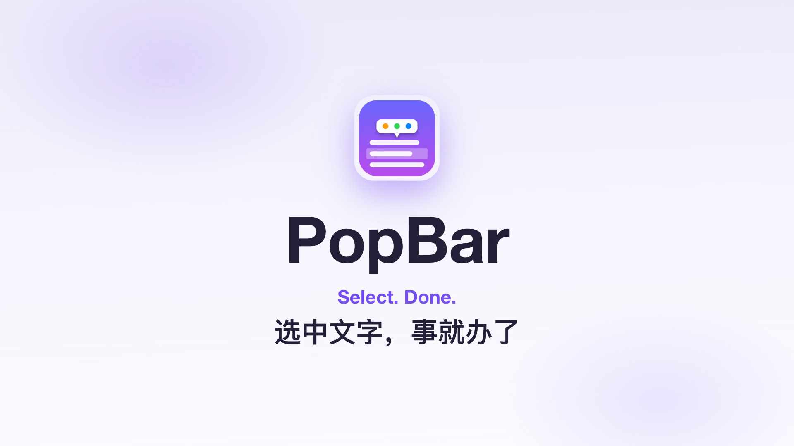
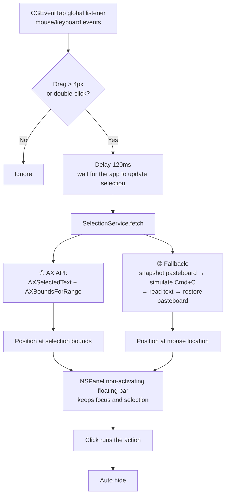
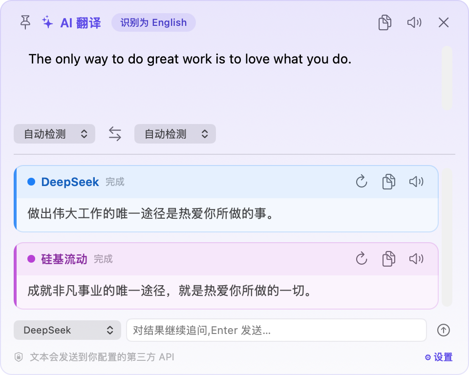
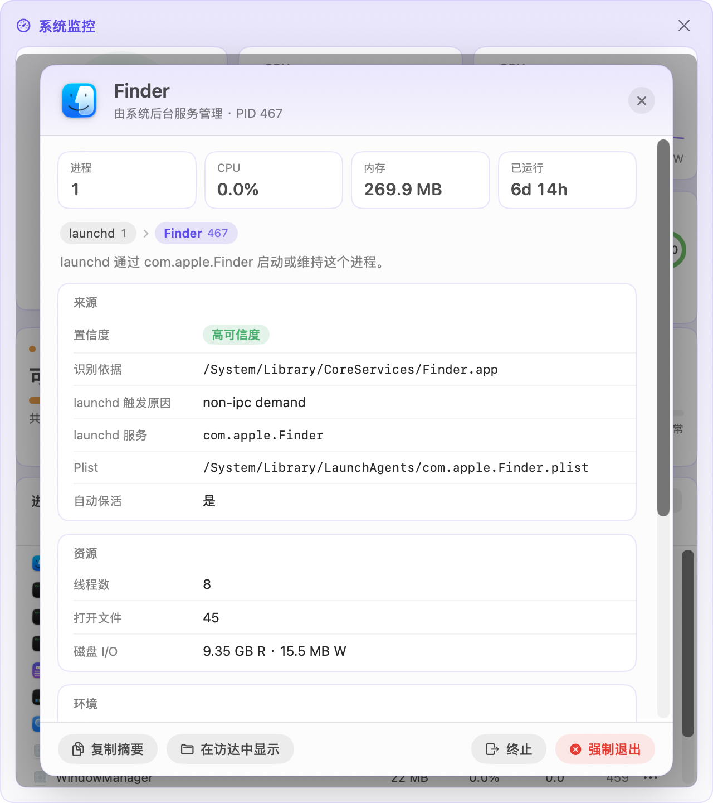
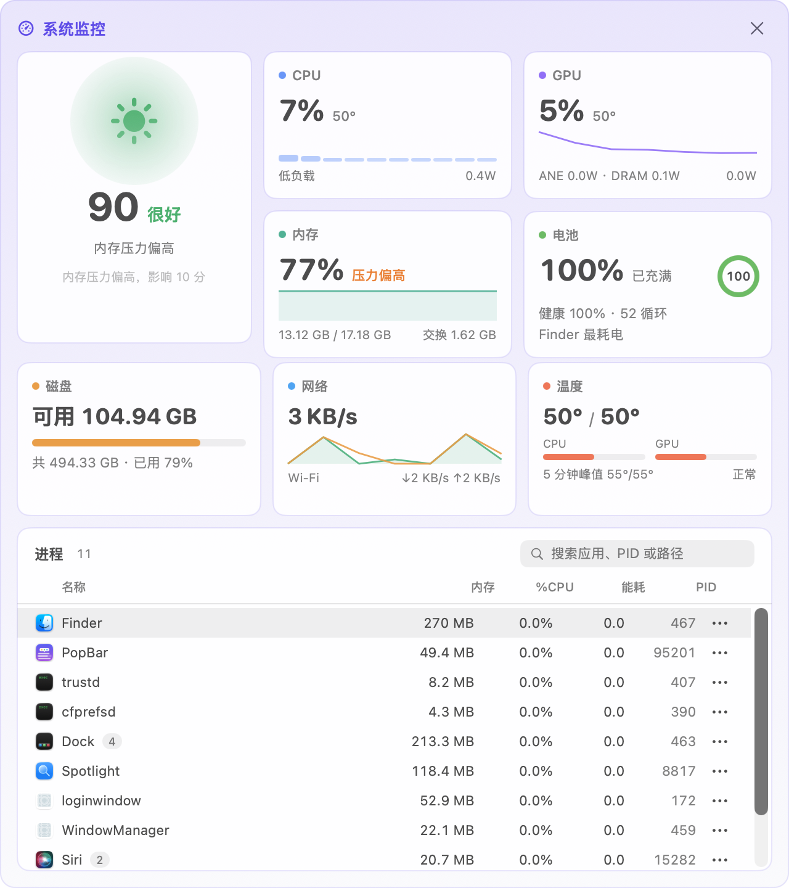
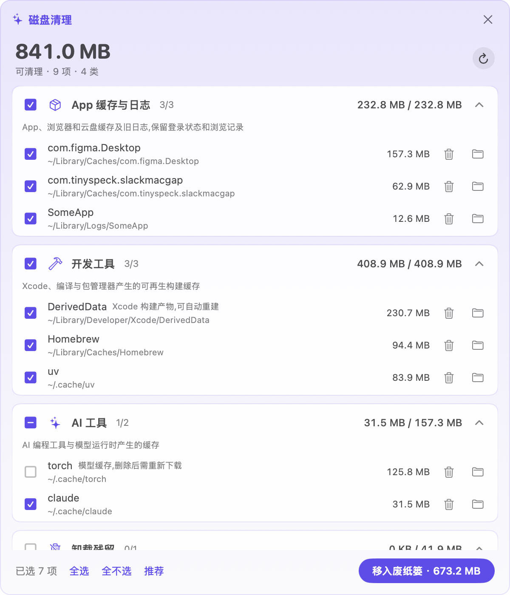
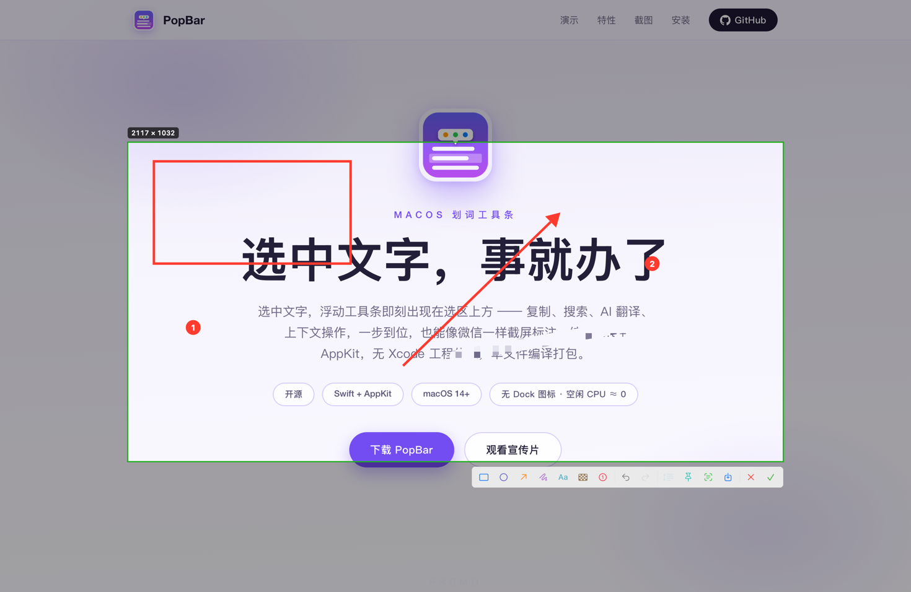
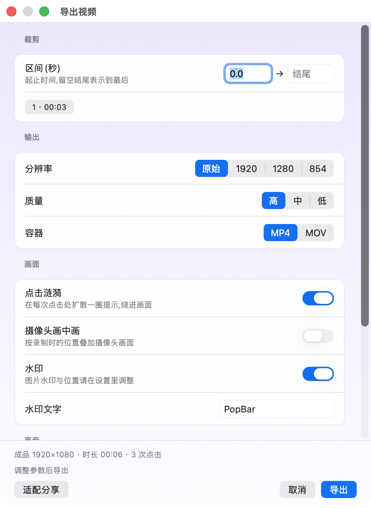
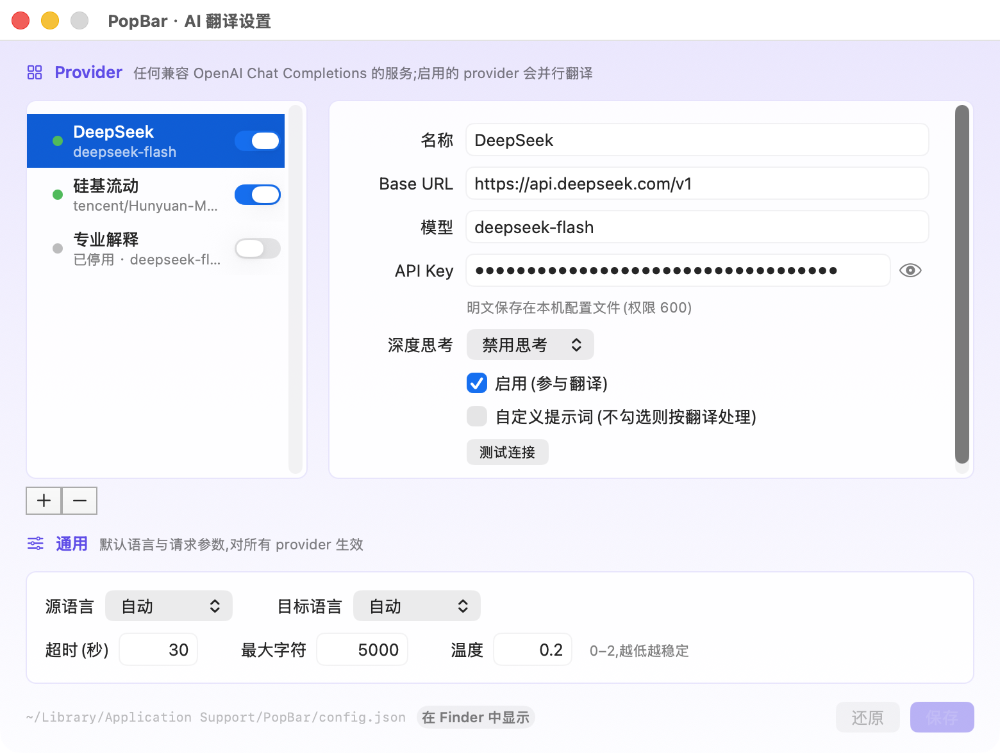
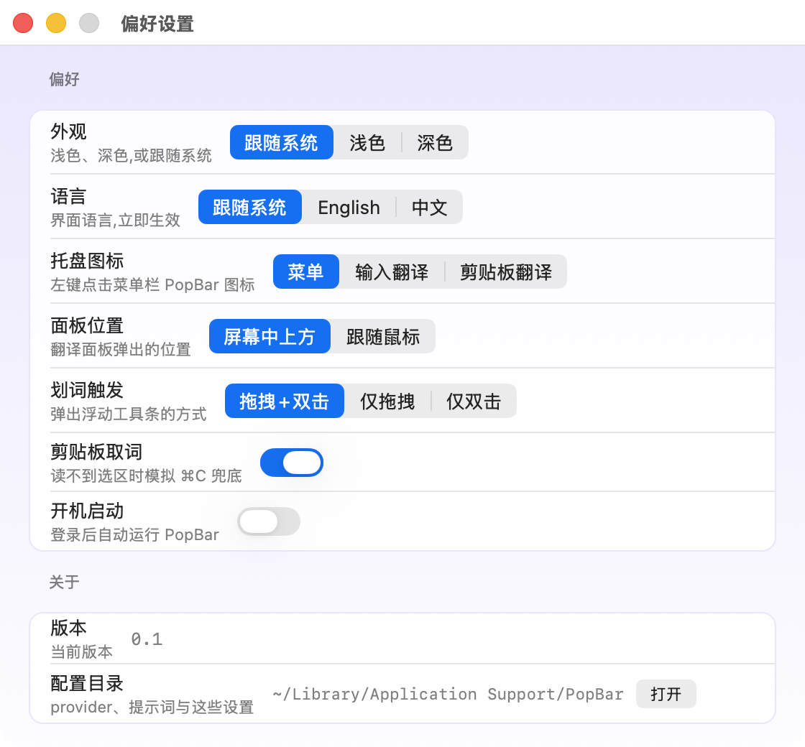

<p align="center">
  
</p>

<h1 align="center">PopBar</h1>

<p align="center">
  A macOS selection popup bar — select text, get a menu.<br>
  Pure Swift + AppKit, no Xcode project required, single-command build.
</p>

<p align="center">
  <a href="README.md">中文</a> | English
</p>

<p align="center">
  <br>
  
</p>

<p align="center">
  <a href="docs/popbar-promo-v2.0.mp4"></a><br>
  <a href="docs/popbar-promo-v2.0.mp4">▶ Watch the promo</a> · <sub>69s: select-to-pop · context-aware actions · AI translation · privacy masking · screenshots · screen recording</sub>
</p>

## Features

- **Select & pop**: after a drag or double-click selection, a floating bar appears above the selection
- **Built-in actions + customizable bar**: clipboard, text processing, search, translation, speech and more; reorder by drag, show/hide in Preferences, overflow folds into a "…" menu
- **AI translation panel**: works with any OpenAI-compatible service (DeepSeek / SiliconFlow / Ollama…); multiple providers stream translations side by side; supports **multi-turn follow-up**
- **Context aware**: detects URL / email / expression / timestamp / JSON / Base64 / URL-encoding / color / file path / phone / address / date / currency / unit, and appends matching buttons (up to 3)
- **Per-app rules**: sensitive apps (1Password, Terminal, …) can disable the bar entirely or keep only chosen actions; one click in the menu bar disables/enables it for the current app
- **Privacy first**: before AI requests, detects phone numbers, ID numbers, bank cards, emails, API keys, private keys, internal IPs — ask / auto-mask / off; clipboard history is off by default and never persisted by default
- **Extension system**: three types — URL template / Shell script (text via stdin, injection-safe) / Shortcut; live on config change
- **More built-in tools**: QR code generation, developer toolbox (HTML/Unicode escape, SHA256/MD5, JWT decode, JSON processing)
- **Screenshot**: WeChat-style capture (`ctrl+opt+p`) — frozen screen, window detection, pixel magnifier and color picker, rectangle/ellipse/arrow/pen/text/mosaic/number annotations, pin to screen, OCR, scrolling capture, optional local history
- **Menu bar translation entries**: screenshot OCR / input / clipboard — three ways to open the translation panel; screenshots and clipboard images are also scanned for QR codes
- **System Monitor**: menu bar → "System Monitor" opens a live panel — health score, CPU (per core) / GPU / memory / battery / disk / network / temperature, plus a process table **grouped by app**, scrollable and searchable; click any row for a **process detail** window (launch chain, launchd reason, confidence, warnings, member processes…), and use the right-click / "…" menu to pin a row, show in Finder, copy name / PID, terminate or force quit. Styled like the translation panel; samples only while the panel is open
- **Disk Cleanup**: menu bar → "Disk Cleanup" scans app caches and old logs, developer tools (Xcode / Homebrew / Cargo / Gradle …), AI-tool caches and uninstall leftovers; sorted by size, checked by group, and **always moved to the Trash** (put-back works). Apps that are running are locked; only your user folders are touched and no admin rights are needed
- **Print Manager**: menu bar → "Print" (`ctrl+opt+o`, configurable) talks directly to macOS's CUPS through the system libcups (no extra dependencies) — six tabs: **Overview / Printers / Jobs / Print / Stats / Manage**. Printers shows status, **ink levels** and paper-out / jam alerts, with pause / resume / reject jobs, alias & note, favorites and a default printer. Jobs can be **canceled / held / released / moved to the front / reprinted as-is**. Print accepts **batches of dropped or chosen files** (PDF / images / HEIC / WebP / plain text, detected by content), **presets**, **per-page thumbnails for page selection**, duplex / color / quality / paper / pages-per-sheet options (validated against the printer's capabilities) and "hold, then release manually". The toolbar gains **Print Selection** (selected text is typeset to PDF; you confirm printer and copies before any paper moves). Also: completion / failure notifications, low-ink alerts, usage charts, network discovery plus add / remove / restore printer, history cleanup (separate retention for other apps' jobs and PopBar's own), backup & restore. It polls only while the panel is open or jobs are queued
- **TV Remote**: menu bar → "TV Remote" (`ctrl+opt+v`, configurable) controls Android TVs on your LAN over ADB-over-TCP (Letv / Xiaomi / TCL / Hisense…) across **Remote / Apps / Screen / Devices** tabs. Remote: D-pad + OK, Back / Home / Menu, media keys, volume slider and mute, standby / wake / reboot, ASCII text input, and your Mac's arrow keys work too. Apps: tap to launch, **drop an .apk to install**, uninstall, optionally show system apps. Screen: a screenshot about every 3 s, copy / save. Devices: **LAN scan** (port 5555 + SSDP + ARP for the MAC, so a changed IP is recognized), add by IP, rename / room, and a **power-on test** (standby wake / Wake-on-LAN / remote-only). The toolbar adds **"Open on TV"** for a selected link (direct video URLs go to the player; a menu picks among several TVs). Install adb yourself (`brew install android-platform-tools` — PopBar doesn't bundle it; the panel guides you when it's missing) and enable ADB debugging on the TV. Polls only while the panel is open
- **Maintenance**: menu bar → "Maintenance" — flush DNS, thin Time Machine local snapshots, rebuild the Spotlight index, tidy the "Open With" database, reset the Quick Look cache. Only operations that actually help; admin tasks use the system password prompt, no privileged helper
- **Today's To-Do + Pomodoro**: menu bar → "To-Do" (`ctrl+opt+t`) — one plain Markdown file per day (default `~/Library/Application Support/PopBar/todo`, can point to a synced folder); unfinished items carry over to today automatically; select text and tap "Add to To-Do" on the bar (records the source app); the panel can be **pinned** on screen (remembers position, restored at launch, never steals focus) and closes on outside click when unpinned; built-in Pomodoro (adjustable focus / break, notification on finish, countdown in the menu bar, daily round count); optional two-way sync with a “PopBar” list in **Reminders** (check-offs, renames, additions and deletions, visible on iPhone too) and each focus round logged as an event in a “PopBar” **Calendar** (both off by default; permission is requested only when you turn them on)
- **Startup Items**: menu bar → "Startup Items" lists login items and background services (LaunchAgent / LaunchDaemon). User-level ones can be toggled (`launchctl enable/disable`, effective after re-login, third-party plists untouched); system-level ones are read-only; broken agents whose program is gone can be moved to the Trash
- **Clipboard history**: opt-in; records text/images/files (up to 10 items, pinnable) with per-item submenu — paste / copy only / append / pin; off by default and memory-only, concealed clipboard markers always skipped
- **Screen Recording**: region / window-following / full-screen capture (`ctrl+opt+r`, macOS 15+) — countdown before capture, H.264/HEVC, MOV/MP4, 30/60fps, system audio + microphone, pause, markers, camera picture-in-picture, click ripples, watermark, one export panel (trim / compress / mix), GIF export
- **Keyboard control**: configurable global hotkey; in keyboard mode ←/→ moves the highlight, Enter runs, Esc closes; the interceptor tap is auto-removed on timeout
- **Bilingual UI**: menu bar, floating bar, translation panel and both settings windows switch between Chinese and English instantly
- **Smart ordering suggestion**: driven by local usage stats (action counts only), suggests pinning a frequent action to the main bar at most once a week
- **Non-invasive capture**: Accessibility API first, falling back to simulated `Cmd+C` with automatic pasteboard restore
- **In-place replacement**: case conversion and the "→ Replace" items in the Dev menu rewrite the original text (pasteboard backed up and restored)
- **Light & dark themes**: frosted-glass material and icon colors follow the system appearance
- **Zero-dependency background app**: `LSUIElement`, no Dock icon, purely event-driven, idle CPU ≈ 0

## Button overview

| Icon | Action | Description |
|---|---|---|
| 📄 | Copy | Write selected text to the pasteboard |
| ✂️ | Cut | Simulates `Cmd+X` |
| Aa | Upper/Lower | In-place replace; all-uppercase becomes lowercase |
| 🔍 | Google | Opens search results in the browser |
| 🐾 | Baidu | Same, via Baidu |
| 💬 | AI Translate | Opens the multi-provider translation panel with streaming output; opens the settings window if no provider is configured |
| 🔊 | Speak/Stop | AVSpeechSynthesizer; Chinese text picks a Chinese voice automatically |
| #️⃣ | Word Count | Shows "X chars · Y words" right in the bar |
| 🔗 | Open Link | Only appears when the selection looks like a URL |
| ✉️ | Send Email | Only appears when the selection is an email address |
| ⊖ | Calculate | Only appears for expressions; copies the result |

> Hovering a bar button shows its name.
> At most 3 context buttons are shown, taken by detection priority: URL, email, calc,
> timestamp, JSON, color, file path, Base64, URL-encoding, currency, unit, phone, address, date.
> Extension actions, QR code, mask, Dev toolbox etc. can all be reordered and toggled in Preferences.

## Keyboard mode

Keyboard selection (Shift + arrows/Home/End/PgUp/PgDn, 0.45 s debounce) also pops the bar;
pressing the summon hotkey (default `ctrl+opt+space`, configurable in Preferences) enters **keyboard mode**:

- `←`/`→` move the highlight, `Enter` runs the action
- `Esc` closes; auto-exits after 30 s idle (prevents the tap from jamming the keyboard)

## Privacy & security

- **Sensitive info detection**: before AI requests, checks phone numbers / ID numbers / bank cards / emails / API keys / private keys / internal IPs; modes: ask / auto-mask / off; masking sends placeholders and restores them in the response; local providers (localhost / internal addresses) are let through directly
- **API keys stay local**: stored in plain text in the local config.json (permission 0600)
- **Secure fields exempt**: when a secure text field (AXSecureTextField) is focused, no capture happens at all — the pasteboard fallback is disabled too
- **Pasteboard protection**: the app's own writes are registered; history never stores temporary content from the capture fallback; ConcealedType / TransientType are always skipped
- **Extension isolation**: Shell / Shortcut extensions receive text only via stdin + environment variables, never interpolated into a command string; 10 s default timeout with SIGKILL
- **App blocklist**: capture can be fully disabled in sensitive apps; one click in the menu bar toggles the current app
- **Screenshot protection**: PopBar's own windows never appear in captures; screenshot history is off by default and, when enabled, stored only locally under Application Support/PopBar/Snaps with a retention limit; nothing is uploaded unless you choose OCR → AI translate yourself

## How it works



Key implementation notes:

- **Event listener**: `.cgSessionEventTap` + `listenOnly`, never blocks the system event stream
- **Capture fallback chain**: AX → pasteboard snapshot/restore (`(type, Data)` materialization avoids `writeObjects:` crashes from lazy-loading items)
- **Panel**: `NSPanel` + `.nonactivatingPanel` — clicking a button never steals focus or clears the selection, which simulating keystrokes to replace the selection depends on
- **Hover feedback**: `NSTrackingArea` + `.activeAlways`, still works for an accessory app
- **Chrome/Electron compat**: automatically sets `AXEnhancedUserInterface`

## AI translation panel

<p align="center">
  
</p>

Clicking the 💬 button on the bar opens a translation panel: the original text sits on top
(selectable, speakable); below it, one card per provider with the translation **streaming** in.
Each card has copy, speak and retry; a failing provider shows its own error without
affecting the others. The panel appears at the top-center of the screen; the 📌 button in
the top-left corner pins it (when pinned, clicking outside won't close it; Esc/✕ still does).

The menu bar offers three more triggers:

| Entry | Description |
|---|---|
| Screenshot Translate (OCR) | System region capture → Vision offline OCR (Chinese + English) → into the panel; requires Screen Recording permission, guided on first use; QR codes in the image are detected too and shown as a clickable result strip |
| Input Translate | The panel's source area becomes an input field; Enter submits, Shift+Enter inserts a newline; edit and re-translate freely |
| Clipboard Translate | Text is translated directly; images are OCR'd first |

Screenshot entries in the menu bar:

| Entry | Description |
|---|---|
| Screenshot | Starts a capture (same as the global hotkey, default `ctrl+opt+p`); see "Screenshot" below |
| System Monitor | Open / close the System Monitor panel; see "System Monitor" below |
| Disk Cleanup | Open / close the Disk Cleanup panel; see "Disk Cleanup" below |
| Screenshot History | Shown when enabled in Preferences and there are records; each item has a thumbnail with Copy / Pin / Show in Finder, plus Open Folder and Clear History at the bottom |

Other menu items: master switch for the selection bar, one-click disable/enable for the
current app, clipboard history (shown when enabled), AI translation settings, Preferences,
Accessibility settings, Quit.
The left-click action on the menu bar icon can be changed to "Input Translate / Clipboard
Translate" in Preferences; right-click always opens the menu.

## System Monitor

Menu bar → "System Monitor" opens a live panel styled like the translation panel (frosted glass + soft purple gradient, light/dark aware). Esc or the ✕ closes it; it can be dragged.

| Section | Content |
|---|---|
| Health score | Combines CPU load, memory pressure, disk space, battery health and cycles, temperature, disk I/O, uptime and drive failure risk into a score, a rating and the contributing factors |
| CPU / GPU | Usage and temperature, per-core bars (CPU) / sparkline (GPU), chip power (CPU / GPU / ANE / DRAM) |
| Memory | Usage and pressure level, sparkline, used / total, swap |
| Battery | Level and charging state, health ring, cycle count, top power consumer (desktops show "No built-in battery") |
| Disk / Network / Temperature | Free space and usage bar; live up/down rates with sparklines; CPU / GPU temperature with 5-minute peaks and thermal state |
| Processes | **Grouped by app** (an app's main process and all its helpers form one row; the small number is the process count, memory / CPU are totals); non-app processes get a row each; sorted by energy impact and **scrollable**; the search box filters by app name, path or any member PID and shows "matches / total"; Esc clears the search first, then closes the panel; **click a row for details** |

### Process detail

<p align="center">
  
</p>

Click a process row (or "Why Is This Running?" in the menu) to open the detail window; Esc closes the detail first and a second Esc closes the panel; × or clicking outside also closes it:

| Section | Content |
|---|---|
| Summary | Process count · CPU · memory · user · one-line source (e.g. "Managed by launchd") |
| Launch chain | `launchd 1 › Cursor 45525`, expandable to the full chain; a sentence below explains the source (launchd service / SSH login / started from terminal X / started by X / unknown) |
| Warnings | Running as root, listening on a public interface, preventing sleep, DYLD injection variables, program file replaced, running over 90 days, stopped, zombie, unknown source |
| Fields | Confidence (high / medium / possible) and evidence, owner (child of an app), launchd reason (`launchctl blame`) and service label, plist / keep-alive / triggers, threads, open files, listening ports, sleep prevention, disk I/O, user, start time, working directory, Git repo, children outside the group, executable |
| Member processes | Top 6 in the group by memory (PID / CPU / memory, with "prevents sleep / public port" markers); the rest are summarized as "N more processes" |
| Raw path and command | Collapsible: executable path and the full command line |
| Actions | Copy Summary, Show in Finder, Terminate, Force Quit |

Terminate / Force Quit confirm first and verify the PID wasn't reused by the system (if the process turned into something else while the window was open, you get "The process changed while you were looking at it"). Critical system processes (PID 1, PopBar itself, root-owned programs under system directories) can't be terminated; permission failures and already-exited processes get clear messages. For an app, Terminate is the same as ⌘Q (it can save), Force Quit sends SIGKILL to all of the app's processes.

Per-process context menu (right-click a row, or the "…" at the end of the row):

| Item | Description |
|---|---|
| Pin Row / Unpin Row | Keep the process at the top of the list (in memory only; cleared when PopBar quits) |
| Why Is This Running? | Opens the process detail above |
| Show in Finder | Selects the process's executable in Finder |
| Copy Process Name / Copy PID | Writes to the clipboard (kept out of clipboard history) |
| Terminate / Force Quit | Ends that row after confirmation (the whole app for an app); rules above |

<p align="center">
  
</p>

Sampling (IOReport / IOKit / libproc — no extra permissions) runs only while the panel is visible and stops on close, so PopBar's idle CPU stays ≈ 0.
The collector is `Native/metrics.c` (C), exposed to Swift through the bridging header `Native/CMetrics.h`. Temperature and per-component power readings exist on Apple Silicon only; on Intel Macs those items show 0 or "—".

## Disk Cleanup

Menu bar → "Disk Cleanup" opens a panel styled like System Monitor and scans immediately (sizes measured concurrently with `du`); Esc or ✕ closes it. **It only cleans your user folders — no admin rights and no privileged helper.**

<p align="center">
  
</p>

| Category | Scanned | Default |
|---|---|---|
| App caches & logs | `~/Library/Caches/*`, `~/Library/Logs/*`, and `~/.cache` folders not in the known-tools list | Caches and logs checked; `com.apple.*` and unknown folders need review (unchecked) |
| Developer tools | Xcode DerivedData / DeviceSupport / SourcePackages, CoreSimulator caches, Cargo, Gradle, Maven, pub, Go modules, Homebrew, `~/.cache` pnpm / uv / pip / playwright …, and the npm cache | Rebuildable items checked; Swift package and Go module caches need review |
| AI tools | `~/.cache` claude / codex / cursor-agent / ollama / torch … | Model caches (torch / ollama) need review |
| Uninstall leftovers | Bundle-id folders in `~/Library/Containers` and `~/Library/Application Support` with no matching app | Never checked by default |
| Manual | Claude VM images, Ollama models, Hugging Face models | Size shown only; not cleaned |

Safety design:

- **Moved to the Trash, recoverable.** A confirmation comes first; space is only freed once you empty the Trash, and the result bar has an "Open Trash" button. The one exception is the **npm cache**: it is content-addressed, so wiping it would destroy every live entry. PopBar does a **reference-graph analysis** instead — it reads `index-v5` for every referenced blob and directly removes only orphan blobs and `tmp/` leftovers (live cache is kept; skipped while npm / node is running)
- **Path re-check**: every item is re-validated at execution time — absolute path, no `..`, not a symlink, inside an allowed root (never the root itself), never a system directory; the review-time checkbox state is not trusted
- **In-use detection**: items whose owning app is running are locked ("In use") and can’t be checked; re-checked again at execution
- PopBar’s own caches and logs, and Safari data, never enter the list
- Operations are logged to `~/Library/Logs/PopBar/clean.log` (time / action / RAN or SKIPPED / count / detail)
- The panel is split into one tab per category; the footer ("selected / All / None / Recommended / Move to Trash") acts on the **current tab only** — selections in other tabs are neither counted nor cleaned
- Each row has "Move to Trash" and "Show in Finder" buttons for single-item cleanup

## Screenshot

Menu bar → "Screenshot" or the global hotkey `ctrl+opt+p`: every screen freezes and dims instantly, and PopBar's own windows never appear in the capture.
Hovering highlights a window and a click selects it; you can also drag a custom region. A toolbar appears below the selection.
It needs the Screen Recording permission, shared with Screenshot Translate, and guides you through granting it on first use.

<p align="center">
  
</p>

- **Magnifier**: while selecting, an 8× pixel magnifier shows the pixel coordinates and RGB/HEX color; press `C` to copy the color under the cursor (can be turned off in Preferences)
- **Annotations**: rectangle, ellipse, arrow, pen, text, mosaic, number; 3 sizes and 6 colors (last choice remembered), undo/redo;
  the selection locks once a tool is selected or an annotation exists. Hold Shift: rectangle/ellipse become square/circle, arrows snap to 45°
- **Output**: Done (copy to clipboard), Save (to the folder set in Preferences, named `PopBar yyyy-MM-dd at HH.mm.ss`, PNG/JPG), OCR (into the translation panel), Pin
- **Scrolling capture**: click the scrolling-capture button on the toolbar and the selection becomes a dashed frame; **scroll the content down slowly** and PopBar stitches it automatically, with a live preview in a panel beside it.
  `Return` or "Done" copies, `Esc` or "Cancel" discards; limit 20000 px; if it says "Scroll slower / Scroll down", adjust how you scroll. Unavailable while annotations exist
- **History**: opt-in in Preferences (off by default); PNGs are stored locally in `Application Support/PopBar/Snaps` and the oldest are pruned beyond the limit (1–200)

| Action | Description |
|---|---|
| `ctrl+opt+p` | Start a screenshot (configurable in Preferences) |
| `Esc` | Cancel (while editing text, the first Esc only commits the text) |
| `Return` / `⌘C` | Done and copy |
| `⌘S` | Save to the configured folder |
| `⌘Z` / `⇧⌘Z` | Undo / redo annotations |
| Arrows / `Shift`+arrows | Nudge the selection 1 pt / 10 pt (while unlocked) |
| `C` | Copy the HEX color under the cursor |
| Double-click selection | Done and copy (when no annotation tool is active) |
| Right-click | Tool active → deselect tool; annotations exist → nothing; selection → back to selecting; otherwise cancel |

**Pin window**: floats where the region was captured and can be dragged; scroll to zoom 10%–500% (anchored at the cursor);
double-click or `Esc` closes; `⌘C` copies; right-click menu: Copy / Save / OCR / Opacity (100% 80% 60% 40%) / Close.

## Screen Recording

Menu bar → "Screen Recording" or the global hotkey `ctrl+opt+r`: the same selection overlay as Screenshot.
Click the **red record button** (or press `Return`) to start; **clicking without dragging records the whole screen**.
**If the selection lands exactly on a window, PopBar records that window and follows it** — moving, resizing
and occlusion are all handled automatically.
By default a 3-second countdown runs before capture starts (0/3/5/10 in Preferences), so you have time to switch
apps and set the scene; the countdown never makes it into the video.
The selection gets a red border and a panel shows the mm:ss timer with **pause / marker / hide / stop**;
the menu bar icon turns into a red timer.

<p align="center">
  
</p>

- **Output**: H.264 / MOV / 30fps / 2x native pixels by default, saved to the same folder as screenshots as
  `PopBar-Rec-yyyyMMdd-HHmmss` (with `-2`, `-3` suffixes on collisions); `SCRecordingOutput` writes to disk as it
  records, so an interrupted session still keeps what was captured
- **Stop**: the panel button, the hotkey again, or the menu item — all equivalent; a notification reports length and
  size and offers **Play / Edit & Export / Export GIF** (a GIF's notification only offers **Play**)
- **Pause**: `ctrl+opt+shift+r` or the panel button; the border turns orange and the timer stops; segments are
  stitched into a single file when you stop
- **Markers**: `ctrl+opt+shift+m` or the panel button; the export panel can jump the trim range to any marker,
  so you do not have to scrub a timeline
- **Follow window**: recording a window keeps the whole window in frame no matter how you move or resize it
- **Click ripples**: clicks are only *recorded* while recording (via a global mouse monitor — **no Accessibility
  permission needed**; clicks on PopBar's own control panel and camera preview are ignored) and baked into the picture on export, so the ring appears exactly where and when you clicked.
  Colour and duration live in Preferences
- **Camera PiP**: turn it on in Preferences (needs Camera permission); a preview window shows the framing while
  recording, and the camera footage is composited into the export
- **Watermark**: text or image, four corners, adjustable opacity
- **Export video**: "Recent Recordings" → "Edit & Export…" opens one panel — trim range, target width
  (Original/1920/1280/854), quality (High/Medium/Low), MP4/MOV, separate system-audio and microphone volumes,
  click ripples, camera PiP and watermark, all applied in a single pass. Output is written with the moov atom first,
  so it plays straight from a web page or chat app
- **Sharing preset**: Preferences → "Apply demo preset" switches to 1x + MP4 + H.264 + 30fps + 3s countdown in one click
- **Record GIF**: ⌥-click the record button to record straight to GIF (≤30s, 10fps, ≤800 wide) and the intermediate
  .mov is deleted; "Recent Recordings" or the notification's "Export GIF" action opens the GIF panel
  (fps / width / range / size estimate / progress / cancel), optionally copying to the clipboard
- **Safety nets**: quitting while recording finalises the file synchronously; a max-duration limit is available;
  the selection is remembered per screen (press `R`)

| Action | Description |
|---|---|
| `ctrl+opt+r` | Start recording / stop while recording / cancel the countdown (configurable) |
| `ctrl+opt+shift+r` | Pause / resume while recording |
| `ctrl+opt+shift+m` | Drop a marker while recording (configurable) |
| `Return` | Start recording the current selection in record mode |
| `R` | Restore the last recording region on this screen |
| `Esc` | Cancel the selection / cancel the countdown |

### Settings window

<p align="center">
  
</p>

Menu bar → "AI Translation…" opens the settings window: provider list on the left (green
dot = ready / orange = missing key or model / gray = disabled) with inline toggles and
**drag-to-reorder** (the order is the card order in the panel); name, Base URL, model, API
key, deep thinking and enabled state on the right; "+" offers presets like DeepSeek,
SiliconFlow, OpenAI, OpenRouter, Ollama; "Test Connection" makes a real request and shows
latency. Below: default language, timeout, max characters and temperature.
"Save" (⌘S) writes the config file; closing with unsaved changes prompts first.

### Preferences

<p align="center">
  
</p>

Menu bar → "Preferences…" (⌘,). Changes take effect **immediately** — no save button. The
window has four tabs: **General / Features / Toolbar / About**, and its height adapts to the
tab content (a tab scrolls internally when it exceeds the available screen height):

| Tab | Content |
|---|---|
| General | Appearance, language, tray icon, panel position, trigger, clipboard fallback, privacy guard, launch at login |
| Features | Clipboard history, history persistence, OCR result, usage stats, summon hotkey; Speech: voice (grouped by language, previewable) and rate; Screenshot: hotkey, save folder, format, magnifier, history and limit |
| Toolbar | Actions & ordering (drag), per-app rules |
| About | Version, config folder |

Item details:

| Item | Description |
|---|---|
| Appearance | System / Light / Dark; all windows and panels switch instantly |
| Language | System / English / 中文; menu bar, bar, panel switch instantly |
| Tray Icon | Left-click action on the menu bar icon: menu / input translate / clipboard translate (right-click always opens the menu) |
| Panel Position | Translation panel at top-center / at cursor |
| Trigger | Drag + double-click / drag only / double-click only |
| Clipboard Fallback | Whether to simulate ⌘C when AX can't read the selection (turning it off better protects pasteboard privacy) |
| Privacy Guard | Check sensitive content before AI requests: ask / auto-mask / off |
| Clipboard History | Records recent text/images/files (≤10, pinnable); per-item submenu paste / copy only / append; plus persist-history, capture-images and capture-files toggles; off by default, memory-only |
| OCR Result | After screenshot recognition: translation panel / full action bar |
| Usage Stats | Counts actions only, never text; powers the weekly ordering suggestion; can be disabled |
| Summon Hotkey | Default `ctrl+opt+space`; format `ctrl+opt+space` |
| Screenshot Hotkey | Default `ctrl+opt+p`; clear it to restore the default |
| Save Folder / Format | Where ⌘S saves screenshots (default `~/Desktop`) and PNG / JPG |
| Magnifier | Show the pixel magnifier and color value while selecting |
| Screenshot History / Limit | Keep a local screenshot history (off by default) and how many to keep, 1–200 |
| Launch at Login | SMAppService login item, synced with System Settings → Login Items |

The About tab shows the version and config folder, with a one-click Finder reveal.

### Config file

Config lives in `~/Library/Application Support/PopBar/config.json` (auto-created on first launch, permission 0600).

- **Loaded at launch, auto-reloaded at runtime**: PopBar watches the file; external edits take effect in ~0.3 s, no restart needed
- If the JSON is broken, the last valid config is kept and the settings window shows the error
- **Screen recording**: `snap.record` — `fps` (30/60), `scale` (1/2), `codec` (h264/hevc), `container` (mov/mp4),
  `showsCursor`, `systemAudio`, `microphone`, `microphoneDevice`, `maxDuration`, `gif.*`, `lastRects`;
  v2 adds `countdown` (0/3/5/10), `windowFollow`, `copyToClipboard`, `click.*` (ripples),
  `camera.*` (PiP), `watermark.*`, `export.*` (autoExport/quality/width/container/volumes/copyToClipboard)
  and `hotkeys.recordMarker`
- **Recording sidecar data** (clicks and markers) lives in `~/Library/Application Support/PopBar/RecordData/<stable-hash>/`
  and is pruned automatically once the video is gone
- You can also write it by hand:

```json
{
  "appearance": "system",
  "language": "system",
  "trayClick": "menu",
  "panelPosition": "top",
  "triggerMode": "both",
  "clipboardFallback": true,
  "launchAtLogin": false,
  "sourceLanguage": "auto",
  "targetLanguage": "auto",
  "timeout": 30,
  "maxCharacters": 5000,
  "temperature": 0.2,
  "hotkeys": {"showBar": "ctrl+opt+space", "history": "opt+cmd+v", "snap": "ctrl+opt+p"},
  "snap": {"saveDir": "~/Desktop", "format": "png", "showMagnifier": true,
           "history": {"enabled": false, "limit": 20}, "lastColor": "#FF3B30", "lastWidth": 1},
  "providers": [
    {
      "name": "DeepSeek",
      "baseURL": "https://api.deepseek.com/v1",
      "model": "deepseek-chat",
      "apiKey": "sk-your-key",
      "enabled": true
    },
    {
      "name": "Local Ollama",
      "baseURL": "http://127.0.0.1:11434/v1",
      "model": "qwen2.5:7b",
      "apiKey": "ollama",
      "enabled": true
    },
    {
      "name": "Word Explainer",
      "baseURL": "https://api.deepseek.com/v1",
      "model": "deepseek-chat",
      "apiKey": "sk-your-key",
      "enabled": true,
      "systemPrompt": "You are a professional vocabulary explainer.",
      "userPrompt": "Explain this word: {$query.text}"
    }
  ]
}
```

- Any **OpenAI-compatible** service works: fill in `baseURL` + `model` + `apiKey`; `enabled` toggles it
- **Deep thinking**: each provider can choose "default / on / off"; the wire format is adapted by domain (DeepSeek `thinking.type`, OpenRouter `reasoning`, Qwen/SiliconFlow/vLLM-style `enable_thinking`); unknown services use the generic form
- **Custom prompts**: with custom prompts enabled, a provider's system prompt and user message template can be changed (turning the bar into an explainer, rewriter, or any task). Template variables: `$query.text` (source text), `$query.detectFromLang`, `$query.detectToLang` (`{$…}` brace form also accepted); results still stream into the panel in translation style. An empty system prompt sends no system message
- `apiKey` is entered in the settings window and stored in plain text in the local config file (permission 0600, readable only by the current user)
- **Extensions**: `extensions` array; `type` is `url / shell / shortcut`; text is passed via `{text}`/`{rawtext}` template variables (url type) or stdin (shell/shortcut), shell also gets `POPBAR_TEXT / POPBAR_APP / POPBAR_BUNDLE_ID` env vars; `output` is `none / copy / replace / show / panel` (both show and panel open the result window); `match` (regex must hit to appear), `apps` (bundleID allowlist), `timeout` (kill after N seconds, default 10), `enabled`
- **Per-app rules**: `appRules`, each `{bundleID, name, mode, actions[]}`; `mode` is `disabled / custom`
- **Toolbar**: `toolbar.items` ordered as `{id, visible}`; `maxVisible` controls buttons on the main bar (default 12, adjustable 4–24), the rest go to the overflow menu; `contextPosition` is `afterEdit / front / back`; `order` is `manual / perApp` (perApp promotes frequently used actions in that app based on usage stats)
- **First-launch seeding**: with no config, a template is written containing 2 disabled provider templates (DeepSeek, SiliconFlow), 1 GitHub-search extension, and 5 preset app-disable rules (1Password / Bitwarden / Keychain Access / Screen Sharing / Windows App)
- **Screenshot**: `snap` — `saveDir` is where ⌘S saves; `format` is `png / jpg`; `showMagnifier` toggles the magnifier; `history.enabled / limit` control screenshot history (off by default, keeps 1–200); `lastColor / lastWidth` remember the last annotation color and size tier (0/1/2)
- **Others**: `clipboardHistory`, `ocr.after`, `usage.enabled`, `hotkeys`, `privacy` etc. can all be handwritten with defaults
- When `targetLanguage` is `auto`, direction is inferred from the source text (Chinese→English, otherwise→Chinese)
- The language dropdown in the panel changes direction for that session only — it's not written back
- Local services are supported (`http://127.0.0.1:...`, `NSAllowsLocalNetworking` is declared in Info.plist)

> ⚠️ When you use this feature, the selected text is sent to **the third-party API you configured** (or a local model).
> PopBar itself has no server and collects nothing, but the target provider's privacy policy applies to the request.
> `apiKey` is stored in plain text in the local config file (readable only by the current user); for safer storage, use a local model (e.g. Ollama).

## Build & install

```bash
./build.sh    # one command: compile (including the C collector in Native/metrics.c) → package build.noindex/PopBar.app → generate build/PopBar-<version>-<arch>.dmg
```

The app bundle is deleted and rebuilt cleanly every time; a same-name DMG is overwritten; the DMG staging directory is cleaned up automatically. Open the DMG, drag `PopBar.app` into `Applications`, and launch it from Applications. The app only shows a menu bar icon — no Dock icon. You can also run the local build directly: `open build.noindex/PopBar.app`. The build and staging directories use the `.noindex` suffix so the dev copy stays out of Spotlight app results.

Requirements: macOS 15+ (screen recording uses ScreenCaptureKit's `SCRecordingOutput`); building from source needs the Swift toolchain and clang (both ship with Xcode or Command Line Tools).

> DMGs downloaded from GitHub Releases are not notarized by Apple, so the first launch reports
> "damaged and can't be opened". After dragging the app into `Applications`, run once in Terminal:
> `xattr -cr /Applications/PopBar.app`.

## Permissions

On first launch, grant **System Settings → Privacy & Security → Accessibility**:

- Global event listening (selection gesture detection)
- Reading selected text
- Simulating keystrokes (`Cmd+C/X/V`)

Separately, **Screenshot**, **Screenshot Translate (OCR)** and **Screen Recording** need **System Settings → Privacy & Security → Screen Recording**; the app guides you through it on first use.
On macOS 15+, the system periodically asks you to re-confirm screen-recording access for third-party apps — that's system behaviour every capture tool gets.
The microphone is off by default; Microphone permission is only needed once you turn it on for recordings.
Camera permission is likewise only needed if you turn on camera picture-in-picture for recordings.

> The AI translation panel needs network access (outbound HTTPS); every other action works fully offline. Selected text is only sent to a service when you actively use search, online lookup or AI translation.

> Installing the DMG does not grant Accessibility automatically. If PopBar is missing from the list, click "+" on that page and choose `/Applications/PopBar.app`. If a `PopBar Dev` certificate exists on this machine it is used for signing, otherwise the app falls back to ad-hoc signing — neither is an Apple Developer ID signature nor notarization, so distribution to other machines may hit Gatekeeper, and Accessibility grants are not guaranteed to survive updates.

## Project structure

```
popbar/
├── Sources/
│   ├── main.swift                    # Entry point
│   ├── AppDelegate.swift             # Status item menu / permission guide
│   ├── SelectionMonitor.swift        # CGEventTap selection gestures + keyboard triggers
│   ├── SelectionService.swift        # AX capture + pasteboard fallback/snapshot restore
│   ├── FloatingBarController.swift   # Bar UI, keyboard mode, info strips
│   ├── BarAction.swift               # Action model + ActionRegistry registration/ordering/split
│   ├── BuiltinActions.swift          # Built-in actions
│   ├── SourceContext.swift           # Context of one capture (text/selection/app)
│   ├── TextReplacer.swift            # In-place replacement (pasteboard backed up & restored)
│   ├── PasteboardGuard.swift         # Pasteboard write registry & snapshot restore
│   ├── ContextDetector.swift         # Context detection (URL/email/calc/timestamp/JSON/color…)
│   ├── TranslationPanel.swift        # AI translation/action panel (provider cards + follow-up)
│   ├── LLMClient.swift               # OpenAI-compatible streaming client (multi-turn messages)
│   ├── PopBarConfig.swift            # config.json structure, path, read/write
│   ├── ConfigStore.swift             # Load at launch + file-watch hot reload + change notification
│   ├── SettingsWindow.swift          # AI settings window (provider CRUD, test connection)
│   ├── PreferencesWindow.swift       # Preferences (General/Features/Toolbar/About, instant apply)
│   ├── PrefsSections.swift           # Toolbar ordering card / app rules card
│   ├── TranslateTriggers.swift       # Screenshot OCR / input / clipboard translate triggers
│   ├── SensitiveGuard.swift          # Sensitive-info detection, placeholder masking, gating
│   ├── Extensions.swift              # URL/Shell/Shortcut extension runner
│   ├── DevTools.swift                # Developer toolbox (escape/hash/JWT/JSON)
│   ├── ClipboardHistory.swift        # Clipboard history (off by default, memory-only)
│   ├── UsageStats.swift              # Usage stats & weekly smart suggestion
│   ├── KeyboardTrigger.swift         # Hotkey parsing + keyboard-mode interceptor tap
│   ├── QRCodePanel.swift             # QR code from selection (CoreImage, offline)
│   ├── ScreenPermission.swift        # Screen Recording permission check/guidance (shared by screenshot and screenshot translate)
│   ├── SnapController.swift          # Screenshot session: freeze → overlays → done/cancel/pin/scrolling capture
│   ├── SnapOverlay.swift             # Overlay window and view: selection, annotation interaction, keyboard
│   ├── SnapGeometry.swift            # Pure geometry: selection, drag, pixel conversion
│   ├── SnapCapture.swift             # ScreenCaptureKit capture + window list
│   ├── SnapMagnifier.swift           # Pixel magnifier and color picking
│   ├── SnapToolbar.swift             # Screenshot toolbar and style bar
│   ├── SnapAnnotation.swift          # Annotation model/drawing, undo stack, mosaic
│   ├── SnapOutput.swift              # Compose annotations, copy, save, OCR
│   ├── SnapPin.swift                 # Pin window
│   ├── SnapScroll.swift              # Scrolling capture: row-hash stitcher + capture loop
│   ├── SnapScrollUI.swift            # Scrolling capture dashed frame and control panel
│   ├── SnapHistory.swift             # Screenshot history storage, pruning and menu
│   ├── RecordSession.swift           # Recording session: countdown, window follow, SCStream + SCRecordingOutput
│   ├── RecordUI.swift                # Recording border, countdown and control panel
│   ├── RecordData.swift              # Sidecar data (clicks/markers/camera), stable-hash store, click monitor
│   ├── RecordExport.swift            # Export pipeline: trim/resize/compress/mix/ripples/PiP/watermark
│   ├── RecordExportUI.swift          # Unified export panel
│   ├── RecordCamera.swift            # Camera PiP: permission, side recording, preview window and layout
│   ├── RecordHistory.swift           # Recent recordings metadata, pruning and menu
│   ├── RecordGIF.swift               # GIF export (frame extraction + ImageIO) and its panel
│   ├── RecordPanelKit.swift          # Shared card / row / section styling for the export panels (matches Preferences)
│   ├── SystemMonitorPanel.swift      # System Monitor panel shell (glass + gradient + SwiftUI content); samples only while open
│   ├── SystemMonitorView.swift       # System Monitor SwiftUI content: metric cards, app-grouped scrollable/searchable process table, context menu
│   ├── SystemMonitorDetailView.swift # Process detail window: summary / launch chain / warnings / fields / members / actions
│   ├── SystemMonitorProcess.swift    # Process layer: libproc wrappers, app grouping, source and confidence, detail collection (launchctl / lsof / IOPM)
│   ├── SystemMonitorModel.swift      # Sampling model (CMetrics snapshot → display data) and health score
│   ├── SystemMonitorActions.swift    # Process actions: Finder / copy / terminate / force quit (system-process protection and PID-reuse check)
│   ├── CleanPanel.swift              # Disk Cleanup panel shell (glass + gradient + SwiftUI content); scans on open
│   ├── CleanView.swift               # Disk Cleanup SwiftUI content: category cards, checkboxes, result bar, manual section
│   ├── CleanViewModel.swift          # Orchestration: scan → concurrent measure → select → execute (to Trash) → log
│   ├── CleanScanner.swift            # Scanner: enumerates caches / logs / build products / leftovers by rule, resolves owning app
│   ├── CleanRules.swift              # Built-in rules: AI / dev-tool folders, fixed paths, manual items, protected names
│   ├── CleanModel.swift              # Cleanup data model: categories, safety levels, items, result summary
│   ├── CleanCore.swift               # Path re-check (CleanPathGuard), size probe, move-to-Trash, operation log
│   ├── CleanNpmGC.swift              # npm cacache reference-graph analysis: removes only unreferenced orphan blobs
│   ├── L10n.swift                    # Chinese/English UI strings
│   ├── Actions.swift                 # CGEvent keystroke simulation (incl. flagsChanged)
│   ├── AppActivation.swift           # Accessory-app foreground activation / Esc-closable window
│   ├── BarTooltip.swift              # Hover tooltip (custom-drawn for non-activating panels)
│   └── Screen.swift                  # CG/AX ↔ Cocoa coordinate conversion
├── Native/                           # System Monitor C collector: metrics.c (IOReport / IOKit / libproc) + CMetrics.h (bridging header)
├── tests/                            # Pure-logic tests + popup-visibility lint (tests/run.sh)
├── shot/main.swift                   # Screenshot tool (standalone binary, reuses Sources)
├── icon/make_icon.swift              # Icon generator (vector drawing → iconset)
├── Resources/AppIcon.icns
├── Info.plist                        # LSUIElement / version / permission usage strings
├── docs/                             # Landing page (index.html), README screenshots and promo video
├── build.sh                          # App/DMG packaging
├── restart.sh                        # Kill old process → build → launch dev copy
├── build/                            # Build artifacts & DMG (not committed)
└── build.noindex/                    # Dev app & packaging staging (excluded from Spotlight)
```

## Helper scripts

```bash
# Restart PopBar: kill the running instance → build → launch the dev copy
# (the most common command after code changes)
./restart.sh              # build + restart
./restart.sh --no-build   # restart only
./restart.sh --fg         # run in foreground, logs straight to the terminal (Ctrl+C to quit)

# Run tests: pure-logic assertions + popup-visibility lint
# (every window/dialog must activate the app before showing)
./tests/run.sh

# Regenerate the icon (after changing colors/layout in icon/make_icon.swift)
swift icon/make_icon.swift icon/PopBar.iconset icon/preview.png
iconutil -c icns icon/PopBar.iconset -o Resources/AppIcon.icns

# Regenerate the bar screenshots used in the README (light + dark)
clang -O2 -target $(uname -m)-apple-macos15.0 -c Native/metrics.c -o build/metrics.o   # System Monitor's C collector
swiftc -O -target $(uname -m)-apple-macos15.0 -o build/shot -import-objc-header Native/CMetrics.h -framework IOKit \
    $(ls Sources/*.swift | grep -v '/main.swift$') shot/main.swift build/metrics.o
./build/shot docs/popbar-bar-light.png docs/popbar-bar-dark.png

# Screenshot-feature showcase image (offline composite over docs/index.html, no Screen Recording needed)
./build/shot --snap docs

# Disk Cleanup panel image (data comes from a temporary sandbox folder, no personal data)
./build/shot --clean docs
```

## Known limitations

- AI translation only supports the OpenAI-compatible protocol; native Claude / Gemini APIs need their own adapters
- In apps with no AX support at all, capture relies on the pasteboard fallback and positioning degrades to the mouse location
- OCR uses offline Vision recognition; accuracy is limited for long passages and small fonts
- The extension system has three lightweight types (URL/Shell/Shortcut); YAML+JS-style plugins are not supported
- Scrolling capture only supports scrolling down; it relies on heuristics for fixed headers/footers, and large blank or animated areas may trigger the "scroll slower" hint; the result cannot be annotated
- Disk Cleanup measures sizes under `~/Library/Caches` etc.; some protected folders need "Full Disk Access" to be measured — unreadable items show "—" and a "Some items couldn’t be measured" hint. System-level folders that need root (`/Library/Caches`, system logs …) are not cleaned
- System Monitor process details rely on `launchctl` (trigger reason / service label) and `lsof` (listening ports); `launchctl procinfo` needs root so it isn't used. Protected system processes whose path can't be read can only show "unknown source"
- System Monitor temperature / per-component power readings rely on Apple Silicon IOReport and show 0 or "—" on Intel Macs; the process list re-sorts by energy every second so rows move; "Why Is This Running?" is a rule-based guess from path and launch chain and stays generic for unusual background programs
- The screenshot hotkey fires through a listen-only event tap, so the key also reaches the frontmost app; the selection can't span screens
- No Developer ID signing or Apple notarization yet; the DMG is fine for local installs/internal testing — public distribution needs proper signing and notarization per Apple requirements

## License

For learning and exchange only.
